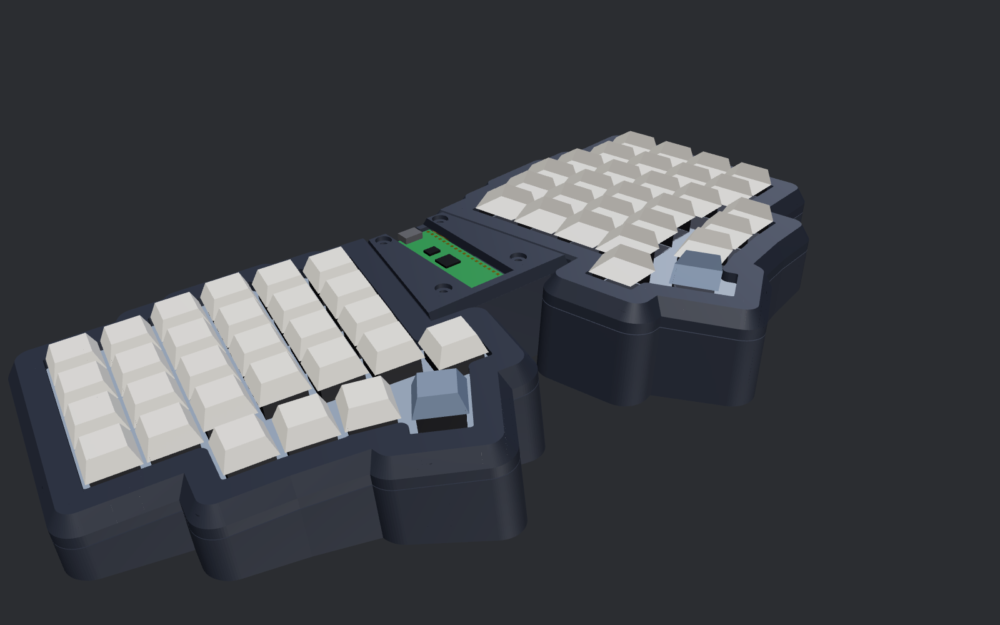

# Compose keyboards

`static func ∘ (lhs: Half, rhs: Half) -> Keyboard`

Unibody, tented and splayed split keyboards, generated entirely from Python, by [edulpn](https://github.com/edulpn).

Compose is a platform: one case generator, one controller board standard and one set of checks, shared by every layout. A layout is a small folder: its keys, where a few pieces of hardware go, and what its keyboard is called. Everything else is generated around it.

*Compose58 rev 2 (in progress: designed and checked, not built yet).*

## Layouts

Each layout has its own pages: status, sizes, parts and check results.

- **[Compose58](layouts/compose58/README.md):** the Lily58 layout (58 keys), by kata0510.

## Docs

- **[Building from source](docs/building.md):** requirements, commands, repository layout, customising.
- **[Rev 2](docs/rev2.md):** the platform's second generation, and its pages:
  - **[The gasket-mount case](docs/gasket-case.md):** how the plates float on foam pads, what prints how, what is checked.
  - **[Controller rev 2](docs/controller-rev2.md):** the shared controller board standard for every layout.
  - **[Rev 2 half boards](docs/half-boards-rev2.md):** the reversible board in its four variants, per-key RGB, firmware, the copper simulation.
- **[How the parts fit together](docs/case-geometry.md):** the case geometry that keeps every part insertable.

## What the platform does

- **One-piece tented, splayed cases.** Splay, tent and tilt are parameters.
- **Reversible half PCBs.** One board serves both halves, in hotswap or solder-in versions, with or without per-key RGB (experimental), with QMK firmware generated alongside.
- **A shared controller standard** ([rev 2](docs/controller-rev2.md)): socketed Raspberry Pi Pico, a 12-pin and an 8-pin PicoBlade connector per half with a reversal-safe pinout (ready-made cables take up each layout's angles), optional RGB, I2C/OLED, Qwiic and AUX.
- **Gasket mount:** plates float on pads cut from ordinary foam weatherstrip tape. The squeeze is set by geometry, not screw torque.
- **Verified, not just drawn.** Every design ships with its checks:
  - fit and clearance between all parts;
  - assembly paths, so every part can actually go in;
  - printability, by slicing each part in its print orientation;
  - board DRC;
  - copper-level matrix and netlist simulation;
  - ngspice simulation of the controller and its cables.

## Getting the files

Ready-made files are attached to the [Releases](../../releases) once a keyboard is built and verified:
- STLs in print orientation;
- JLCPCB-ready Gerbers;
- QMK `keyboard.json`;
- BOM and build notes.

Each layout's page links its releases. You don't need any of the toolchain to build from one. Rev 2 has no release yet: nothing of it is built.

**Rev 1**, the generation before this one (a screwed sandwich mount, PicoBlade cables), was built as Compose58 and is no longer in this repository: its files are in the release [`compose58-rev1`](https://github.com/edulpn/compose-keyboards/releases/tag/compose58-rev1) and its source is at the tag [`compose58-rev1-final`](https://github.com/edulpn/compose-keyboards/tree/compose58-rev1-final).

## Licensing

Compose is free to build for yourself: print the parts, order your own PCBs, fork it, remix it. Selling kits, boards or printed parts made from it needs my permission.

- **The keyboard designs are [CC BY-NC-SA 4.0](LICENSE-CC-BY-NC-SA-4.0).** That covers the generator code and its parameters and layouts, everything it produces (STLs, STEPs, KiCad boards, Gerbers, firmware definitions, renders), and the docs and images.
- **Generic helpers are [MIT](LICENSE).** That covers the render/preview scripts in `compose/render/web/`, which contain no keyboard design.
- **Third-party material** keeps its own license, listed in [NOTICE.md](NOTICE.md). That includes the Lily58 layout (MIT, Naoki Katahira) and three.js in the render helpers (MIT).
- **Commercial use:** for kits, group buys or selling boards, open an issue or get in touch.
- **Contributing:** see [CONTRIBUTING.md](CONTRIBUTING.md).
