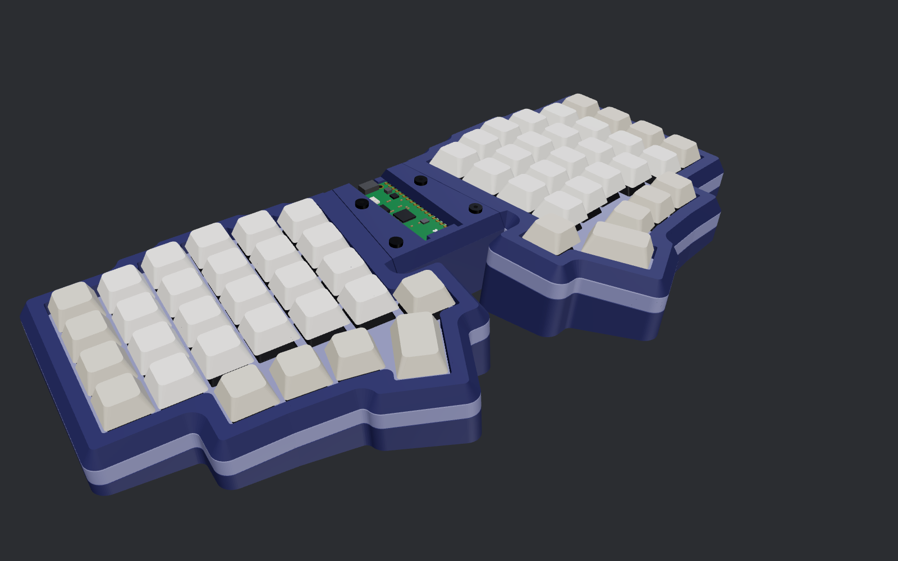
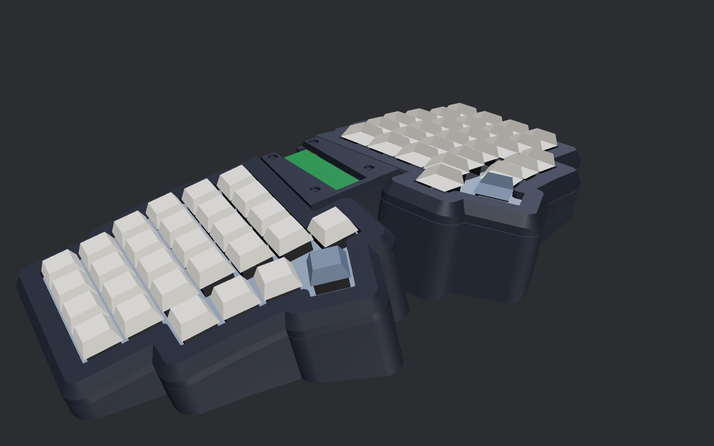

# Compose keyboards

`static func ∘ (lhs: Half, rhs: Half) -> Keyboard`

Unibody, tented and splayed split keyboards, generated entirely from Python, by [edulpn](https://github.com/edulpn).

Compose is a platform: one case generator, one controller board standard and one set of checks, shared by every layout. A layout is just a key list; everything else is generated around it.

| Compose58 rev 1 (built) | Compose58 rev 2 (in progress) |
|---|---|
|  |  |

## Layouts

Each layout has its own pages: revisions, build guides, status and releases.

- **[Compose58](layouts/lily58/README.md):** the Lily58 layout (58 keys), by kata0510.

## Docs

- **[Building from source](docs/building.md):** requirements, commands, repository layout, customising.
- **[Controller rev 2](docs/controller-rev2.md):** the shared controller board standard for every layout.
- **[How the parts fit together](docs/case-geometry.md):** the case geometry that keeps every part insertable.
- **[Pointer modules](docs/pointer-modules.md):** the pointer mount standard (a slot in place of the 1.5u thumb key, a thumb bay on the case) and the devices that meet it, starting with a trackball.

## What the platform does

- **One-piece tented, splayed cases** for 350 mm-class printers. Splay, tent and tilt are parameters.
- **Reversible half PCBs.** One board serves both halves, in hotswap or solder-in versions (rev 2 adds optional per-key RGB, experimental), with QMK firmware generated alongside.
- **A shared controller standard** ([rev 2](docs/controller-rev2.md)): socketed Raspberry Pi Pico, fixed jumper connectors with a reversal-safe pinout (custom flex jumpers take up each layout's angles), optional RGB, I2C/OLED, Qwiic and AUX.
- **Gasket mount:** plates float on pads cut from ordinary foam weatherstrip tape. The squeeze is set by geometry, not screw torque.
- **Verified, not just drawn.** Every revision ships with its checks:
  - fit and clearance between all parts;
  - assembly paths, so every part can actually go in;
  - printability, by slicing each part in its print orientation;
  - board DRC;
  - copper-level matrix and netlist simulation;
  - ngspice simulation of the controller;
  - the flex jumpers bent as elastic strips: fit, insertion and copper fatigue (rev 2).

## Getting the files

Ready-made files are attached to the [Releases](../../releases), one per layout revision:
- STLs in print orientation;
- JLCPCB-ready Gerbers;
- QMK `keyboard.json`;
- BOM and build notes.

Each layout's page links its releases and build guide. You don't need any of the toolchain to build one.

## Licensing

Compose is free to build for yourself: print the parts, order your own PCBs, handwire it, fork it, remix it. Selling kits, boards or printed parts made from it needs my permission.

- **The keyboard designs are [CC BY-NC-SA 4.0](LICENSE-CC-BY-NC-SA-4.0).** That covers the generator code and its parameters and layouts, everything it produces (STLs, STEPs, KiCad boards, Gerbers, firmware definitions, renders), and the docs and images.
- **Generic helpers are [MIT](LICENSE).** That covers the render/preview scripts in `compose/render/web/`, which contain no keyboard design.
- **Third-party material** keeps its own license, listed in [NOTICE.md](NOTICE.md). That includes the Lily58 layout (MIT, Naoki Katahira) and three.js in the render helpers (MIT).
- **Commercial use:** for kits, group buys or selling boards, open an issue or get in touch.
- **Contributing:** see [CONTRIBUTING.md](CONTRIBUTING.md).
