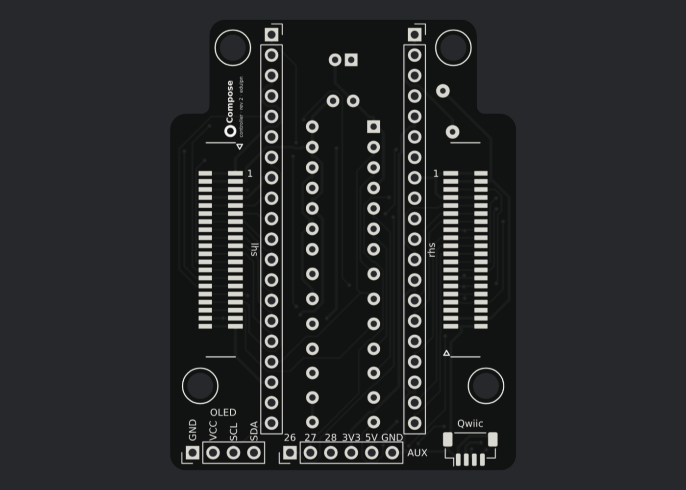
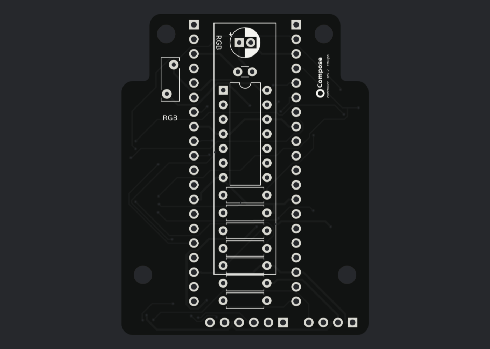

# Controller rev 2

[Home](../README.md) › Docs › Controller rev 2

The shared controller board for every Compose split layout: one board, one connector standard and one firmware pin map, so any layout's half boards plug into the same controller. Nothing on it depends on a layout's angles: each layout's flex jumpers take those up.

| top | bottom |
|---|---|
|  |  |

| command | what it does |
|---|---|
| `python3 -m compose controller out` | builds, routes and DRC-checks `out/pcb/controller_rev2.*` (KiCad board, JLCPCB Gerber zip, previews) |
| `python3 -m compose controller out --resilk` | redraws only the silkscreen on the routed board (DRC and Gerbers, no re-route) |
| `python3 -m compose sim-controller out` | copper-level simulation |
| `python3 -m compose spice-controller out` | ngspice simulation |

It is a breaking change from rev 1 (PicoBlade cables, 10 × 12 matrix).

**On this page:** [Board](#board) · [Jumper connectors and slot order](#jumper-connectors-and-slot-order) · [Pins](#pins) · [Front connectors](#front-connectors) · [Optional RGB](#optional-rgb) · [BOM](#bom) · [Simulation](#simulation)

## Board

| | |
|---|---|
| size | 43 × 56 mm, Pico centred, USB at the back. Behind the jumper connectors it narrows to 33.2 mm (\|x\| ≤ 16.6) to clear the plates' inner gasket seats. |
| standard | outline, holes, heights and keep-outs live in `compose/controller/rev2_std.py`; cases read them from there |
| top face | only the Pico sockets, the two jumper connectors and the front connector row |
| bottom face | every passive and the optional RGB buffer (through-hole, soldered from the top), so nothing is limited by the Pico's 8.5 mm socket height; the rev 2 case leaves 24 mm under the board |
| parts | all through-hole except the two jumper connectors and the Qwiic connector |

**Placement checks** (asserted on every build): courtyards inside the board and apart on each face; no part's body over a through-hole pin or solder joint from the other face (the pad's copper against the courtyard, so a bottom part's top-side joint can't lift a top connector); top connectors clear of the Pico; standoffs and posts clear of everything; nothing in the jumpers' path.

**Mounting (part of the standard):**

- Four M3 holes, at (±17.75, +19.5) beside the Pico's front end and (±13.7, −22.5) beside its USB end (mm from the Pico centre).
- M3 × 12 male–female hex standoffs (5 or 5.5 mm across flats, 6 mm thread) screw through the board into M3 heat-set inserts in four case posts, clamping it.
- The cover drops onto the standoffs and takes four M3 × 6 screws: the same screws and M3 × 5 × 4 inserts as the rev 2 frames, so the whole keyboard uses one screw size.
- Each hole keeps a 6.6 mm circle free of parts and copper on top. No bottom part sits over a post, and no through-hole lead comes within 4.0 mm of one.

**Silkscreen:**

- Rev 1's art font (DejaVu Sans). The ∘ ring and "Compose" title stand up the left strip beside the Pico (mirrored on the bottom); "RGB" outline and labels are on the bottom silk.
- Every label sits against what it names: `lhs` / `rhs` along each jumper connector's contact row with "1" beside slot 1's contact; pin names standing on each header's outline; "OLED" centred over its header's pin names; "AUX" at the end of its own header row; "Qwiic" right behind its connector.

## Jumper connectors and slot order

- **Connectors:** two Molex 52610-2072 (Easy-On, 20 positions, 1.0 mm pitch, vertical, slider latch) on the top face, square to the side edges. Slot plane at 14.8 mm either side of the Pico centre, centred 2.6 mm forward of it, contact face toward the Pico. Footprint from Molex's recommended pattern: two tails per contact, one either side of the body. The title moved behind the connectors to make room.
- **Fixed by the standard:** these positions are in `compose/controller/rev2_std.py` and no layout changes them. A layout sets only where its halves' connectors sit; its jumper's shape does the rest.
- **Jumpers:** a custom single-sided flex per half, 20 conductors at 1.0 mm pitch, 0.3 mm thick at the fingers, conductors toward the contact face; it goes 4.1 mm straight down into the slot. On a half board the connector is a Molex 200528-0200 (right angle, bottom contact) on the bottom face. Compose58 rev 2's: [flex jumpers](../layouts/lily58/rev2.md#flex-jumpers).
- **Slot order:** slot 1 is the back-most contact. Both connectors use the same physical order, so the right connector is turned 180° and its pad numbers run backwards.

| slot | 1 | 2 | 3 | 4 | 5–11 | 12–17 | 18 | 19 | 20 |
|---|---|---|---|---|---|---|---|---|---|
| line | GND | 5 V LED | RGB data to the half | GND | COL0–6 | ROW0–5 | RGB data back | 5 V LED | GND |

**Reversal-safe:** should slot k ever meet 21 − k (a jumper made the wrong way round), 5 V lands on 5 V, GND on GND and the two RGB data lines on each other through the 330 Ω; rows and columns just scramble. The RGB line into the half sits between 5 V and GND.

> Never set `MATRIX_UNSELECT_DRIVE_HIGH`: with the slots reversed, slot 4's GND would meet ROW5.

## Pins

QMK `keyboard.json`, also written to `out/pcb/controller_rev2_qmk.json`:

| function | pins |
|---|---|
| matrix | 6 × 14, `COL2ROW` |
| rows | GP0–5, shared by both halves |
| left columns COL0–6 | GP6–12 |
| right columns COL0–6 | GP22, 21, 20, 19, 18, 17, 16 (COL0 = the outer pinky column on both halves), so the matrix columns left to right are GP6–12, GP16–22 |
| RGB data | GP13 (`ws2812` vendor driver); chain controller → left half → controller → right half |
| I2C1 | SDA GP14, SCL GP15, 4.7 kΩ pull-ups to 3.3 V |
| AUX header | GP26, GP27, GP28 (ADC), 3.3 V, 5 V (VBUS), GND |

## Front connectors

| connector | pins | notes |
|---|---|---|
| OLED-style header | 4: GND, VCC = 3.3 V, SCL, SDA (printed on the board) | also takes a PS/2 pointing stick (below) |
| AUX header | 6 | see [Pins](#pins) |
| Qwiic / STEMMA QT | JST SH 4-pin, top entry | the cable rises straight to a module in the cover |

Modules mount in the bridge cover and plug in with short cables.

**PS/2 pointing stick** on the I2C header: power it from 3.3 V (the VCC pin), or remove the stick's own pull-ups. A 5 V stick with pull-ups would push the RP2040 pins past their 3.8 V limit.

## Optional RGB

Outlined "RGB" on the bottom silkscreen. Leave it empty for no RGB: firmware RGB off, and the jumpers' 5 V lines stay dead. **Fit the whole group or none of it** (a buffer without the fuse is back-fed through its input).

| part | role |
|---|---|
| U2 74HCT125 (DIP-14) + C1 100 nF | buffer, 3.3 → 5 V data |
| R3 330 Ω | series resistor on the data line out |
| R4 100 kΩ | pull-down: keeps the data low before the Pico boots, so the LEDs don't latch noise at plug-in |
| U2's second gate, R5 220 Ω in, R6 100 kΩ pull-down, R7 330 Ω out | re-drives the chain on its way from the left half to the right half. Wired straight through, the two jumper runs ring too much (see the simulation). R5 limits clamp current. |
| F1 Bourns MF-RHT050 | polyfuse, VBUS → LED 5 V; stands on the bottom face beside the Pico, back right |
| C2 10 µF | bulk capacitor (with 100 µF the hot-plug dip on the USB port would be 1.7× a spec-limit device instead of 1.4×) |

All of the RGB group except F1 sits in the box under the Pico on the bottom face.

- **Firmware:** `RGB_MATRIX_MAXIMUM_BRIGHTNESS 32`. 84 LEDs at full white stay under 450 mA: the fuse holds 0.5 A and USB gives 0.5 A in total.
- **Rev 2 halves:** DIN from slot 3 to the first LED, the last DOUT back on slot 18; a pass-through link when a half has no LEDs; one 100 nF per 2–4 LEDs rather than per LED (hot-plug inrush).

## BOM

| ref | part | qty |
|---|---|---|
| U1 | Raspberry Pi Pico / Pico W / Pico 2 (W) or pin-compatible, on 2 × 1×20 female headers (8.5 mm) | 1 |
| JL, JR | Molex 52610-2072 FFC/FPC connector, 20 pos, 1.0 mm, vertical, slider latch | 2 |
| — | flex jumpers, one per half, made for the layout (Compose58 rev 2: `jumper_rev2_L` and `_R`) | 2 |
| J4 | 1×4 2.54 mm header (OLED / I2C) | 1 |
| J6 | 1×6 2.54 mm header (AUX) | 1 |
| J5 | JST BM04B-SRSS-TB (Qwiic, top entry) | 1 |
| R1, R2 | 4.7 kΩ axial | 2 |
| — | M3 × 12 male–female hex standoffs (5 or 5.5 mm AF, 6 mm thread) + M3 × 6 button-head screws for the cover + M3 × 5 × 4 heat-set inserts for the case posts | 4 + 4 + 4 |
| *RGB:* U2 | 74HCT125, DIP-14 | 1 |
| *RGB:* C1 | 100 nF ceramic, 2.5 mm pitch | 1 |
| *RGB:* R3, R7 / R4, R6 / R5 | 330 Ω / 100 kΩ / 220 Ω axial | 2 / 2 / 1 |
| *RGB:* F1 | Bourns MF-RHT050 polyfuse (bottom face, standing) | 1 |
| *RGB:* C2 | 10 µF 16 V electrolytic, 5 mm diameter, 2.0 mm pitch, up to 11 mm tall (bottom face) | 1 |

## Simulation

Copper level: `compose/sim/controller_copper.py`. ngspice: `compose/sim/controller_spice.py`, report in `out/sim_controller_rev2/report.md`. Result: **0 failures**, 2 warnings (hot-plug dip, 5 V pointing stick).

| what | result |
|---|---|
| netlist | rebuilt from the routed copper, it matches an independent pin-level spec (Pico, jumper connector slots with both tails of each 52610 terminal joined and the contact face toward the Pico, DIP pin 1 and its pin order as seen from the face the chip sits on, polarised C2, headers, Qwiic); silkscreen pin labels match the copper |
| optional RGB group | behaves correctly fitted and empty |
| key scan | QMK COL2ROW through two model jumpers (slot k to slot k) into model halves: all 84 keys, 1000 random chords, no ghosting (including across the shared rows); slots reversed are harmless |
| negative controls | swapped firmware pin, unrotated right connector, reversed diodes, injected short, cut track: all caught |
| RGB data (192 corners: drive strengths, jumper 20–100 mm and 100–180 Ω, LED rail down to 4.3 V) | clean single edges at the LED; '0' 340–363 ns and '1' 890–913 ns (spec 250–550 / 650–950); overshoot ≤ 0.3 V. Without the buffer, 3.3 V data passes in only 8 of 24 corners. |
| chain hop (96 corners) | re-driven by gate 2: in spec everywhere, input clamp current ≤ 6.2 mA. Wired straight through it failed half the corners (0.96 V overshoot). |
| I2C | 400 kHz with up to 60 pF of bus on the board's pull-ups, 100 kHz to 100 pF; modules with their own 2.2–10 k pull-ups stay in spec |
| power | the far LED stays ≥ 3.76 V at 450 mA (the LEDs' minimum is 3.7 V), even with a tripped-and-recovered fuse and the thinnest flex copper (1/3 oz, 100 mm). Hot-plug dip with RGB fitted is 1.4× a USB spec-limit device, mostly from the halves' LED decoupling (warning). |
| matrix timing | a pressed key reads 0.47 V (VIL 0.8 V), settles in 53 ns (QMK samples at ~250 ns) and recovers in 3.3 µs (QMK waits 30 µs); worst jumper/board crosstalk leaves idle lines ≥ 2.75 V (limit 2.0 V) |
| PS/2 stick | fine from 3.3 V; a 5 V stick with its own pull-ups would exceed the RP2040's 3.8 V limit (warning) |
| with real halves | `sim-half-rev2` scans this board's copper end to end with the Compose58 rev 2 half boards (see [rev 2](../layouts/lily58/rev2.md#the-half-boards)); through the real flex jumpers' copper; their 26 mm is inside the 20–100 mm the circuit simulation covers |
