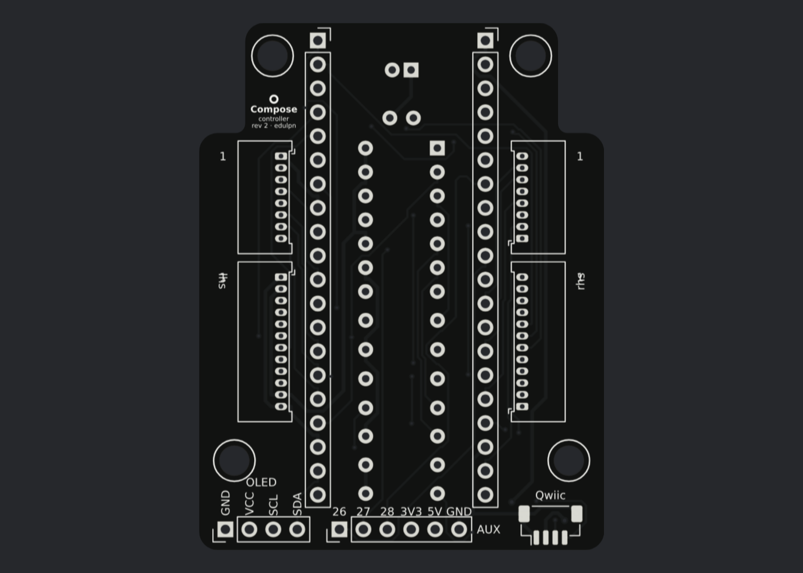
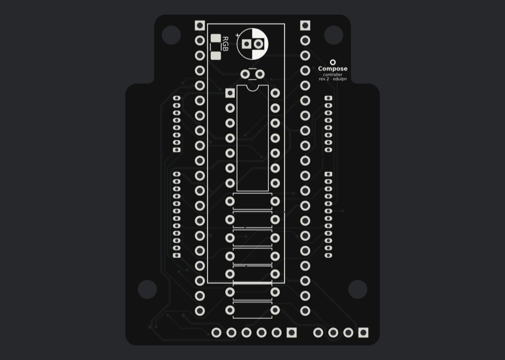
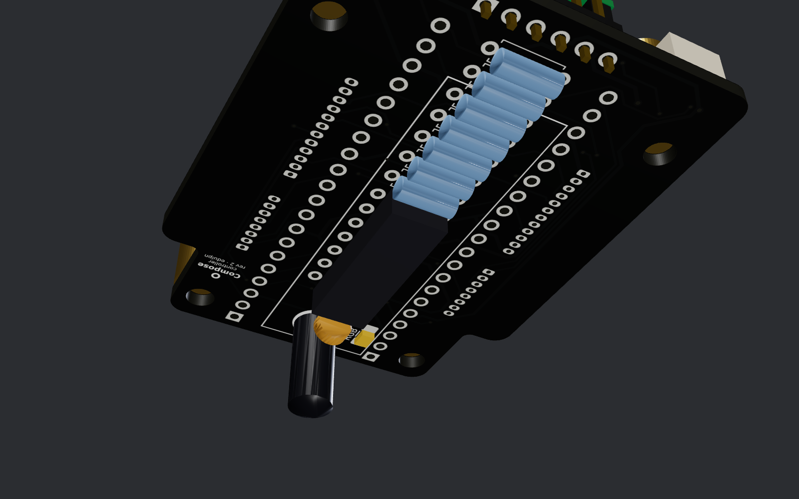

# Controller rev 2

[Home](../README.md) › Docs › [Rev 2](rev2.md) › Controller rev 2

The shared controller board for every Compose split layout: one board, one connector standard and one firmware pin map, so any layout's half boards plug into the same controller. Nothing on it depends on a layout's angles: the cables between it and the halves take those up.

| top | bottom |
|---|---|
|  |  |

*Underside, fully fitted (render from `gasket-render`, parts placed from the routed board's footprints).*

| command | what it does |
|---|---|
| `python3 -m compose controller` | builds, routes and DRC-checks `out/controller/pcb/controller_rev2.*` (KiCad board, JLCPCB Gerber zip, previews) |
| `python3 -m compose controller --resilk` | redraws only the silkscreen on the routed board (DRC and Gerbers, no re-route) |
| `python3 -m compose sim-controller` | copper-level simulation |
| `python3 -m compose spice-controller` | ngspice simulation |

**On this page:** [Board](#board) · [Cable connectors and slot order](#cable-connectors-and-slot-order) · [Pins](#pins) · [Front connectors](#front-connectors) · [Optional RGB](#optional-rgb) · [BOM](#bom) · [Simulation](#simulation)

## Board

| | |
|---|---|
| size | 43 × 56 mm, Pico centred, USB at the back. Behind the cable connectors it narrows to 33.2 mm (\|x\| ≤ 16.6) to clear the plates' inner gasket seats. |
| standard | outline, holes, heights and keep-outs live in `compose/controller/rev2_std.py`; cases read them from there |
| top face | only the Pico sockets, the four cable connectors and the front connector row |
| bottom face | every passive and the optional RGB buffer (through-hole, soldered from the top, except the 1206 polyfuse), so nothing is limited by the Pico's 8.5 mm socket height; the rev 2 case leaves 16.5 mm under the board |
| parts | all through-hole except the Qwiic connector and the polyfuse |

**Placement checks** (asserted on every build): courtyards inside the board and apart on each face; no part's body over a through-hole pin or solder joint from the other face (the pad's copper against the courtyard, so a bottom part's top-side joint can't lift a top connector); top connectors clear of the Pico; standoffs and posts clear of everything; no standoff in the way of a cable's plug.

**Mounting (part of the standard):**

- Four M3 holes, at (±17.75, +20.5) beside the Pico's front end and (±13.7, −22.5) beside its USB end (mm from the Pico centre).
- M3 × 12 male–female hex standoffs (5 or 5.5 mm across flats, 6 mm thread) screw through the board into M3 heat-set inserts in four case posts, clamping it.
- The cover drops onto the standoffs and takes four M3 × 6 screws: the same screws and M3 × 5 × 4 inserts as the rev 2 frames, so the whole keyboard uses one screw size.
- Each hole keeps a 6.6 mm circle free of parts and copper on top. No bottom part sits over a post, and no through-hole lead comes within 4.0 mm of one.

**Silkscreen:**

- The half boards' art font (DejaVu Sans). The ∘ ring, "Compose" and the board's name sit stacked in the narrowed strip behind the left cable connector, beside the Pico (mirrored on the bottom); "RGB" outline and labels are on the bottom silk.
- Every label sits against what it names: `lhs` / `rhs` just outside each side's cable connectors, centred along the 12-pin, with a "1" level with each connector's first slot (slots 1 and 9: pin 1 on the left side; on the right side, where the connectors are turned to open outward, pin 1 is at the front end and the "1" marks the last pin); pin names standing on each header's outline; "OLED" centred over its header's pin names; "AUX" at the end of its own header row; "Qwiic" right behind its connector. The build stops if any two labels on the top face touch: KiCad's DRC doesn't compare one board graphic with another.

## Cable connectors and slot order

- **Connectors:** on each side a Molex PicoBlade 53048-0810 (8 positions) behind a 53048-1210 (12 positions), 1.25 mm pitch, right angle, through-hole, end to end on the top face along the side edge, openings outward. KiCad's own footprints; the build compares each body outline with the sizes the case uses and prints both. Pin rows 12.8 mm either side of the Pico centre, the row centred 1.45 mm forward of it: far enough in that the mated plugs clear the half boards (0.6 mm), and clear of the Pico's sockets. The two connectors fill the strip between the board's narrowing at the back and the front standoffs, 0.45 mm to spare at each end.
- **Fixed by the standard:** these positions are in `compose/controller/rev2_std.py` and no layout changes them. A layout's half boards put their connectors level with these rows; the cables take up the angles.
- **Cables:** ready-made PicoBlade cables (Molex 51021 housings at both ends, sold as "MX1.25" too), an 8-pin and a 12-pin per half, 150 mm; anything from 100 to 200 mm is inside what the simulation covers, down to 32 AWG wire. Different sizes, so the two cables of a half can't be swapped. On a half board the connectors are a PicoBlade 53047-0810 and 53047-1210 (vertical, through-hole) on the bottom face ([rev 2 half boards](half-boards-rev2.md#cable-connectors)).
- **Slot order:** the 20 contacts are numbered as slots by physical position, slot 1 the back-most pin: the 8-pin holds slots 1–8, the 12-pin 9–20. The columns sit behind the rows, as they did in the single-connector plan the half boards were first routed with, and run from the front of the 8-pin: COL0 (the outer column) in slot 8, next to the 12-pin, and COL6 (spare on most layouts) in slot 2, at the back. On a half board the back end of the row is the most crowded spot, beside the top row's inner key: the column that ends there is the inner one, and the outer columns leave from the front end, toward the gap below the top row. Both sides use the same physical order, so the right connectors are turned 180° and their pad numbers run backwards.
- **Which way round:** the right-angle connectors only sit one way on their footprints, opening outward. A cable crimped the other way round reverses its own slots at the half (harmless, below), and turning the half's connector round puts it right.

| slot | 1 | 2–8 | 9 | 10 | 11 | 12–17 | 18 | 19 | 20 |
|---|---|---|---|---|---|---|---|---|---|
| line | GND | COL6–0 | GND | 5 V LED | RGB data to the half | ROW0–5 | RGB data back | 5 V LED | GND |
| cable | 8-pin | | 12-pin | | | | | | |

**Reversal-safe:** should an 8-pin cable meet the half the other way round (slot k on 9 − k), GND lands on COL0 and the columns on each other; a 12-pin one (k on 29 − k) puts 5 V on 5 V, GND on GND, the two RGB data lines on each other through the 330 Ω and the rows on each other. Nothing is damaged, keys just scramble. A column is only ever an input with its pull-up (`COL2ROW`), so GND on it is harmless whatever the firmware's unselect setting.

## Pins

QMK `keyboard.json`, also written to `out/controller/pcb/controller_rev2_qmk.json`:

| function | pins |
|---|---|
| matrix | 6 × 14, `COL2ROW` |
| rows | GP0–5, shared by both halves |
| left columns COL0–6 | GP12, 11, 10, 9, 8, 7, 6 |
| right columns COL0–6 | GP16–22 (COL0 = the outer pinky column on both halves; on each side the column pins run in the order of their slots, so the tracks to the connector don't cross), so the matrix columns left to right are GP12–6, GP22–16 |
| RGB data | GP13 (`ws2812` vendor driver); chain controller → left half → controller → right half |
| I2C1 | SDA GP14, SCL GP15, 4.7 kΩ pull-ups to 3.3 V |
| AUX header | GP26, GP27, GP28 (ADC), 3.3 V, 5 V (VBUS), GND |

## Front connectors

| connector | pins | notes |
|---|---|---|
| OLED-style header | 4: GND, VCC = 3.3 V, SCL, SDA (printed on the board) | also takes a PS/2 pointing stick (below) |
| AUX header | 6 | see [Pins](#pins) |
| Qwiic / STEMMA QT | JST SH 4-pin, top entry | the cable rises straight to a module in the cover |

Modules mount in the bridge cover and plug in with short cables.

**PS/2 pointing stick** on the I2C header: power it from 3.3 V (the VCC pin), or remove the stick's own pull-ups. A 5 V stick with pull-ups would push the RP2040 pins past their 3.8 V limit.

## Optional RGB

Outlined "RGB" on the bottom silkscreen. Leave it empty for no RGB: firmware RGB off, and the cables' 5 V lines stay dead. **Fit the whole group or none of it** (a buffer without the fuse is back-fed through its input).

| part | role |
|---|---|
| U2 74HCT125 (DIP-14) + C1 100 nF | buffer, 3.3 → 5 V data |
| R3 330 Ω | series resistor on the data line out |
| R4 100 kΩ | pull-down: keeps the data low before the Pico boots, so the LEDs don't latch noise at plug-in |
| U2's second gate, R5 220 Ω in, R6 100 kΩ pull-down, R7 330 Ω out | re-drives the chain on its way from the left half to the right half. Wired straight through, the two cable runs ring too much (see the simulation). R5 limits clamp current. |
| F1 Bourns MF-NSMF050-2 | polyfuse, VBUS → LED 5 V; 1206 on the bottom face, beside the Pico's VBUS pin (back right) |
| C2 10 µF | bulk capacitor (with 100 µF the hot-plug dip on the USB port would be 1.7× a spec-limit device instead of 1.3×) |

The whole RGB group sits in the box under the Pico on the bottom face. F1 is the board's one surface-mount part besides the Qwiic connector: a 1206 with hand-soldering pads. A radial polyfuse doesn't fit any more: the strip behind the right cable connectors, where it stood, is taken by the two connectors.

- **Firmware:** `RGB_MATRIX_MAXIMUM_BRIGHTNESS 32`. 84 LEDs at full white stay under 440 mA: the fuse holds 0.5 A, and USB gives 0.5 A in total, of which 60 mA are kept for the Pico and its modules.
- **Rev 2 halves:** DIN from slot 11 to the first LED, the last DOUT back on slot 18; a pass-through link when a half has no LEDs; one 100 nF per 2–4 LEDs rather than per LED (hot-plug inrush).

## BOM

| ref | part | qty |
|---|---|---|
| U1 | Raspberry Pi Pico / Pico W / Pico 2 (W) or pin-compatible, on 2 × 1×20 female headers (8.5 mm) | 1 |
| JL1, JR1 | Molex PicoBlade 53048-0810, 8 pos, 1.25 mm, right angle | 2 |
| JL2, JR2 | Molex PicoBlade 53048-1210, 12 pos, 1.25 mm, right angle | 2 |
| — | PicoBlade (MX1.25) cables, 150 mm (100–200 mm works), ready-made, both ends female: 8-pin and 12-pin; each half board takes a PicoBlade 53047-0810 and 53047-1210 vertical connector at the other end | 2 + 2 |
| J4 | 1×4 2.54 mm header (OLED / I2C) | 1 |
| J6 | 1×6 2.54 mm header (AUX) | 1 |
| J5 | JST BM04B-SRSS-TB (Qwiic, top entry) | 1 |
| R1, R2 | 4.7 kΩ axial | 2 |
| — | M3 × 12 male–female hex standoffs (5 or 5.5 mm AF, 6 mm thread) + M3 × 6 button-head screws for the cover + M3 × 5 × 4 heat-set inserts for the case posts | 4 + 4 + 4 |
| *RGB:* U2 | 74HCT125, DIP-14 | 1 |
| *RGB:* C1 | 100 nF ceramic, 2.5 mm pitch | 1 |
| *RGB:* R3, R7 / R4, R6 / R5 | 330 Ω / 100 kΩ / 220 Ω axial | 2 / 2 / 1 |
| *RGB:* F1 | Bourns MF-NSMF050-2 polyfuse, 1206 (bottom face; LCSC C75464) | 1 |
| *RGB:* C2 | 10 µF 16 V electrolytic, 5 mm diameter, 2.0 mm pitch, up to 11 mm tall (bottom face) | 1 |

## Simulation

Copper level: `compose/sim/controller_copper.py`. ngspice: `compose/sim/controller_spice.py`, report in `out/controller/sim_controller_rev2/report.md`. Result: **0 failures**, 3 warnings (hot-plug dip, the buffer's supply at USB's lowest voltage, 5 V pointing stick).

| what | result |
|---|---|
| netlist | rebuilt from the routed copper, it matches an independent pin-level spec (Pico, the cable connectors' slots, an 8-pin behind a 12-pin in one row with the bodies outward, DIP pin 1 and its pin order as seen from the face the chip sits on, polarised C2, headers, Qwiic); silkscreen pin labels match the copper |
| optional RGB group | behaves correctly fitted and empty |
| key scan | QMK COL2ROW through model cables (slot k to slot k) into model halves: all 84 keys, 1000 random chords, no ghosting (including across the shared rows); a cable reversed is harmless |
| negative controls | swapped firmware pin, unrotated right connector, reversed diodes, injected short, cut track: all caught |
| RGB data (192 corners: drive strengths, cable 100–200 mm and 100–180 Ω, half-board trace 30–200 mm, LED rail down to 4.3 V) | clean single edges at the LED; '0' 337–366 ns and '1' 887–916 ns (250–400 / 650–950 allowed: the windows both the WS2812B and the SK6812 MINI-E accept); overshoot ≤ 0.3 V. Without the buffer, 3.3 V data passes in only 8 of 24 corners. |
| chain hop (96 corners) | re-driven by gate 2: in spec everywhere, input clamp current ≤ 6.9 mA. Wired straight through it failed half the corners (0.96 V overshoot). |
| I2C | 400 kHz with up to 60 pF of bus on the board's pull-ups, 100 kHz to 100 pF; modules with their own 2.2–10 k pull-ups stay in spec |
| power | at USB's lowest voltage (4.75 V at the port, 4.5 V at the device after the cable) the far LED stays ≥ 4.08 V at 440 mA (the LEDs' minimum is 3.7 V), even with a tripped-and-recovered fuse and 200 mm cables of 32 AWG wire. That is the average: the brightness cap is a PWM duty, and at a current peak (about 21 of 84 LEDs on at once, 0.82 A) the far LED dips to 3.97 V with a new fuse and 3.52 V after a trip, for under 0.1 ms at a time. At 440 mA the 74HCT125 runs from 4.14 V, under the 4.5 V its data sheet starts at (warning; 4.39 V from a 5.0 V host). Hot-plug dip with RGB fitted is 1.5× a USB spec-limit device, with a 100 nF capacitor per two LEDs on the halves (warning). |
| matrix timing | a pressed key reads 0.47 V (VIL 0.8 V), settles in 64 ns (QMK samples at ~250 ns) and recovers in 4.0 µs (QMK waits 30 µs); the worst cable or board crosstalk leaves idle columns ≥ 3.22 V (limit 2.0 V) and idle rows ≥ 2.39 V (limit 1.6 V) |
| PS/2 stick | fine from 3.3 V; a 5 V stick with its own pull-ups would exceed the RP2040's 3.8 V limit (warning) |
| with real halves | `sim-half-rev2` scans this board's copper end to end with the Compose58 rev 2 half boards (see [rev 2](../layouts/compose58/rev2.md#the-half-boards)), through model 8-way and 12-way cables; the 150 mm cables are inside the 100–200 mm the circuit simulation covers |
