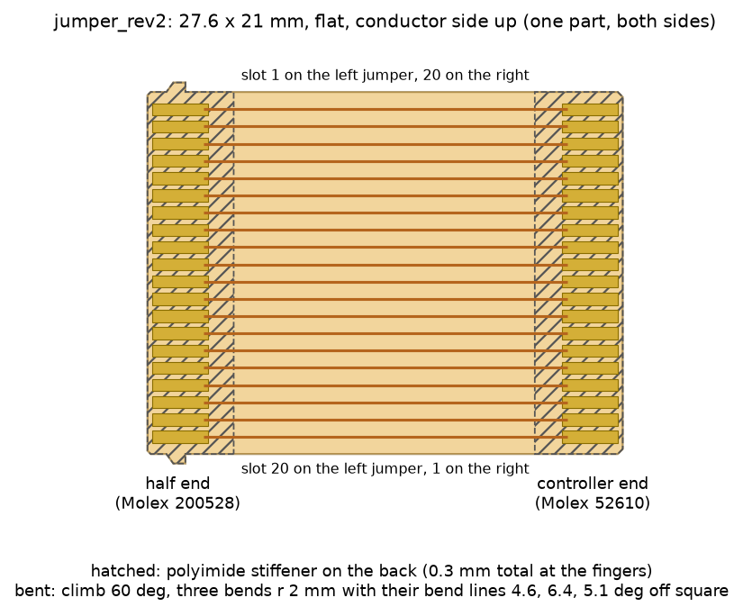
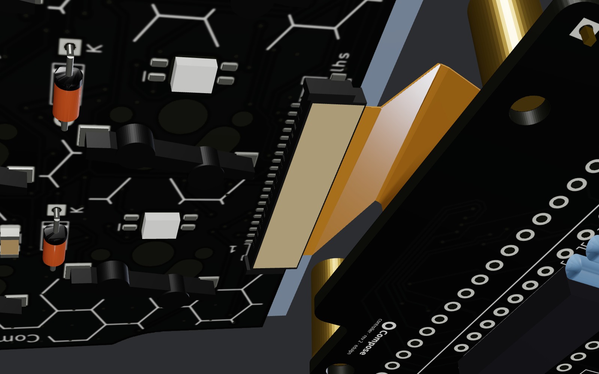
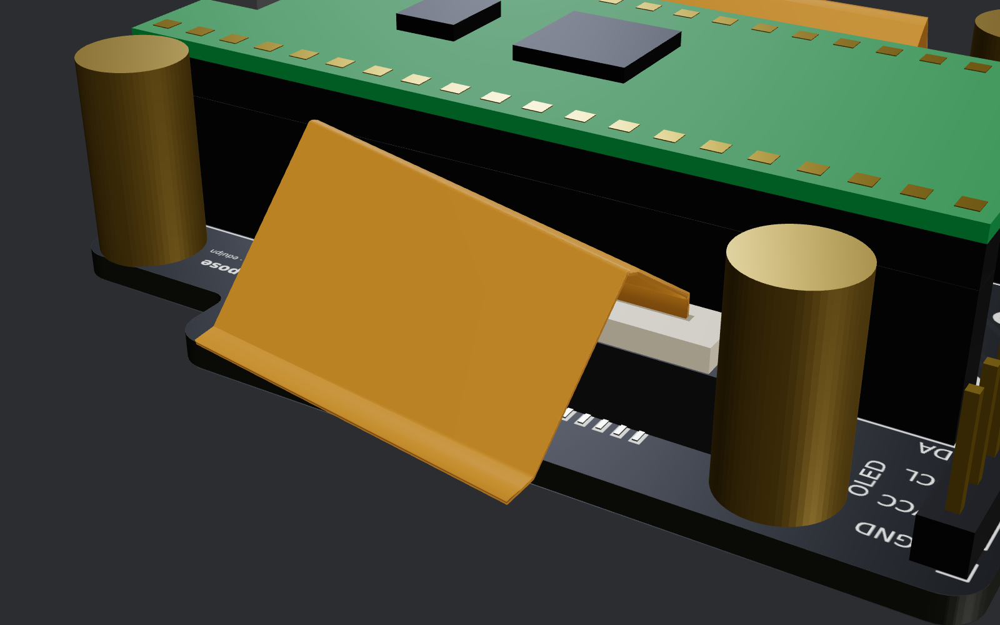
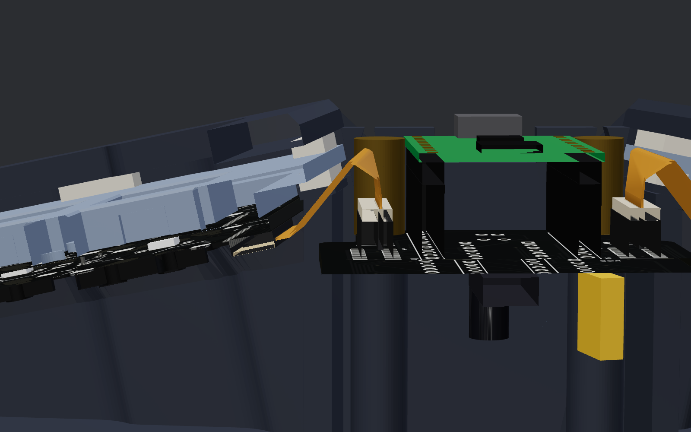

# Flex jumpers

[Home](../README.md) › Docs › [Rev 2](rev2.md) › Flex jumpers

| half end: into the Molex 200528 | controller end: down into the Molex 52610 |
|---|---|
|  |  |

*Compose58's jumper. The jumper in these renders is the shape `flex-sim` settles it into, not the idealised design.*

The controller's two connectors are vertical (Molex 52610) and square to its edges; each half's connector runs along the half's splayed, tented edge. A custom flex PCB joins each pair. It ships flat and takes its bends by itself once both ends are plugged in: the clamped ends and its length leave it one easy shape, with nothing twisted and nothing hanging loose. `python3 -m compose flex-jumper` solves the shape from the case and writes the board (`compose/pcb/jumper.py`).

**One part for both halves**, like the half boards: the flat strip is straight and symmetric. On the left it's bent one way, on the right as the mirror image, so there's one design to order. Its conductors are straight across, so each one joins the same physical slot at both ends whichever side it's on: slot 1 on the left jumper is slot 20 on the right one, and that doesn't matter.

| | |
|---|---|
| path, from the half | 1 mm of stiffener out of the connector, a bend up into a climb, a bend over, a short straight, a bend down into a short drop, 1 mm of stiffener above the controller's slot |
| bends | three, r 2 mm, each a plain cylindrical bend. Their bend lines cross the strip a few degrees off square: that's what turns it by the splay, so nothing twists and the flat strip needs no curve. The straights between them are long enough that neighbouring bend lines never meet. |
| size | 21 mm wide (22.1 mm across the half end's retention ears), and as long as the solved path plus 0.5 mm of slack, which eases the bends while the controller end goes in (see the simulation below) |
| conductors | 20, 0.5 mm wide at 1.0 mm pitch, one side only |
| half end (200528) | 0.7 mm gold fingers, 3.5 mm exposed, retention ears 0.55 mm proud between 1.5 and 2.2 mm from the tip; conductors face up |
| controller end (52610) | 0.7 mm gold fingers, 3.5 mm exposed, two C0.3 chamfers; conductors face inboard, toward the Pico |
| stiffeners | polyimide on the back of each end, 5.0 mm at the half end and 5.1 mm at the controller end; both connectors take 0.3 ± 0.05 mm at the fingers |

The climb, the bend angles, the skews and the length are solved for each layout's case. Compose58's, with its DRC and simulation results: [its page](../layouts/compose58/rev2.md#flex-jumper).

**Ordering (JLCPCB, Flex):** upload `jumper_rev2_JLCPCB.zip`, one design, 2 per keyboard. It's laid out as a 2-layer flex (much cheaper there than 1-layer) with nothing on the back copper. `python3 -m compose order-rev2` puts every rev 2 board's zip (controller, half boards, jumper), each checked against its routed board, into `out/<layout>/order` with an ORDER.md of these settings.

| field | choose | why |
|---|---|---|
| Layers | 2 | the back copper is empty; its coverlay stays whole |
| Substrate | 25 µm dielectric | |
| PCB thickness | 0.11 mm | with the 0.20 mm stiffener, about 0.3 mm at the fingers |
| Coverlay | yellow, PI 12.5 µm / AD 15 µm | |
| Copper type | rolled annealed | the half end rides on the gasket mount, so the jumper flexes a little with every keystroke, and its copper stretches ~2.3 % for a moment while it's plugged in: RA copper takes both better |
| Surface finish | ENIG, 1 U″ gold | Molex asks for gold over nickel; the jumper is plugged a handful of times |
| Gold fingers | No | that option is hard gold for card-edge connectors; ENIG covers these contacts |
| EDA software | Other | |
| Stiffener | Polyimide, 0.20 mm | areas in `jumper_rev2-Stiffener_PI_bottom.gbr` (JLC reviews them by hand when the design isn't from EasyEDA) |
| Confirm production file | Yes | to check the stiffener areas and the finger thickness before they build |
| Remark | "PI stiffener 0.20 mm on the bottom side, areas in the Stiffener_PI_bottom file (one under each finger field). Finished thickness at the fingers 0.30 ± 0.05 mm (FPC connectors Molex 200528 and 52610). Bottom copper is intentionally empty." | |

**Will the real strip take that shape?** `python3 -m compose flex-sim` (`compose/checks/flex_sim.py`) lets it find its own. The strip is modelled as a sheet that can't stretch, folded along straight lines across it: the exact structure of a bent flex, so it bends and twists the way a real one does. It's clamped by the two connectors and settles into the shape of least bending, which is then checked against the case model. Strain is judged at the copper (the outermost conductors' outer edges); the bare polyimide edge takes far tighter bends.

| scenario | what is judged |
|---|---|
| seated | how far it settles from the designed path, its tightest bend and the strain at the copper (limit 1.5 %) |
| insertion: the controller end lifted 4.1 mm to go into its slot | that it reaches the slot, and the copper strain for that moment (limit 2.5 %: half of rolled-annealed copper's ~5 % minimum elongation) |
| gasket travel: the half end moving with the plate, ±0.2 mm per keystroke (a generous bound by the inner-edge pads) | how far each conductor flexes, against the fatigue limit (0.2 %, ≥ 10⁷ cycles) |
| rare excursions, 0.5–1.0 mm | that it settles every time, and the copper strain (low-cycle) |
| clearances, seated, over the travel and ±0.5 mm of length | plate, cover, half board, controller board; no overlap with either connector or anything else |

**Fitting:** plug the jumper into the half's connector first (fingers toward the half board, then close the actuator), then set the board in. With the cover off, open the controller connector's slider, curl the free end up and over and push it straight down into the slot, then close the slider. Don't pre-bend or crease it: the curves form by themselves once both ends are in. Molex's application spec asks for straight insertion and no tension; the length and shape give both.
