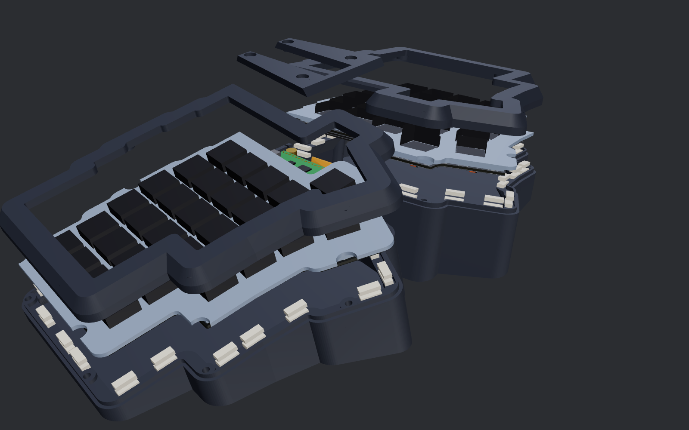

# The gasket-mount case

[Home](../README.md) › Docs › [Rev 2](rev2.md) › Gasket-mount case

The rev 2 case: a one-piece tub, plates that float on foam pads, bevelled frames and a lift-off middle cover. It is generated round the layout's keys and the [controller rev 2](controller-rev2.md) board (`compose/case/gasket.py`). Sizes, counts and check results for a keyboard are on its own page ([Compose58](../layouts/lily58/rev2.md#the-case)).

All rev 2 commands need `C58_REV=2` (rev 1 is the default and is untouched).

| command | what it does |
|---|---|
| `gasket-case out_r2t` | builds the printable parts into `out_r2t/print/` (`compose/case/gasket.py`) |
| `gasket-checks out_r2t` | fit, gasket, assembly, jumper and printability checks |
| `gasket-sections out_r2t` | cross-section drawings |
| `gasket-render out_r2t` | renders, including assembly views with the real boards (their Gerbers as textures), the parts of a hotswap RGB build and the jumpers as `flex-sim` settles them |

## Defaults

| | default | override |
|---|---|---|
| splay | 10° | `C58_SPLAY` |
| tent | 12° | `C58_TENT` |
| tilt | 0° | `C58_TILT` |
| bridge | 62 mm, 2.5 mm end walls | |

The angles come from an ergonomics research pass and stay provisional until the angle test prints are tried.

## Parts

Everything prints without supports, in print orientation:

| part | qty | prints | why |
|---|---|---|---|
| tub (both halves and the open middle bay) | 1 | on its floor (Compose58's is 332 × 161 mm, for a 350 mm bed) | the pad ledge runs back to the wall on a smooth 60° chamfer underneath instead of hanging off it |
| plates | 2 | switch side down, as on rev 1 | the flange (flush with the top face) lies flat on the bed; the switch-clip pockets open upward |
| frames | 2 | upside down, visible top on the bed | bevels are 56° from the bed |
| middle cover | 1 | upside down, visible top on the bed | same |

- **Look:** rev 1's bevelled frames (6 mm tall, 4 mm inset) and the reveal line over the tub's top edge. Outer corners are rounded at 4.5 mm so the bevel stays clean all the way round.
- Every mesh is checked watertight with no non-manifold edges, and sliced layer by layer for overhangs.

## How the gasket mount works

- Each **plate** is a 5 mm core holding the switches, with a thin 2 mm flange round its edge, flush with its top face.
- The **flange is pinched between foam pads**: pads on a ledge in the tub below, pads under the frame above. Nothing screws through the plate or the half board.
- Each **frame** screws to the tub from below with M3 screws into heat-set inserts (six per frame on Compose58) and bottoms out on the tub's bosses. The squeeze is set by geometry, not by how hard the screws are tightened.
- The plate **floats 0.6 mm clear** of the walls and the frame sideways.

## Pads: ordinary foam weatherstrip tape

| | |
|---|---|
| material | self-adhesive closed-cell EPDM or neoprene sponge |
| tape | 1/8″ (3 mm) thick, 3/8″ or 10 mm wide |
| pad | a 4 mm slice cut across the tape with scissors: 10 mm along the edge, 4 mm inward |
| where | stuck to the tub's ledge and to the frame's underside |
| squeeze | installed at 2.1 mm: 30–34 % for 3.0–3.2 mm tape (the foam is happy at 25–50 %) |
| count | as many pairs as fit round the plate (20 per half on Compose58) |

The pairs are found by scanning the plate edge for every spot where a slice fits between the plate edge and the half board. Two more sit at the ends of the inner (bridge) edge, on seats that stand straight up from the floor so they don't lean into the controller.

## Middle bay

- The controller sits on four floor posts (M3 inserts), clamped by its four M3 standoffs; there are 24 mm under the board.
- The cover drops onto the standoffs and takes four M3 × 6 screws. It comes off without touching the jumpers.
- The bay is open from wall to wall below the plates' inner edges, so each jumper climbs out of its half's connector, crosses the gap and drops straight into the controller's connector ([flex jumpers](flex-jumper.md)).

## What `gasket-checks` verifies

Every check runs on the generated solids, for the layout as built:

- **overlaps:** none between parts that mustn't touch: tub, plates, frames, cover, the controller board and the parts on both its faces, the Pico stack, standoffs, the real underside parts of every half-board variant, the jumpers, the pads;
- **clearances** between plate and tub, plate and frame, cover and frames, board and tub, Pico and cover;
- **pad gap:** the same at every pad, top and bottom, measured on the solids along the plate normal;
- **assembly paths:** plates and frames drop in along the plate normal; the controller and the cover drop straight down ([how the parts fit together](case-geometry.md));
- **hardware:** thread engagement of the cover screws and the standoffs, the Pico's gap, the header plugs under the cover;
- **jumpers:** the bent shape solved from the case, clear of the plate (by the gasket's travel), the half board, the cover, the standoffs and the Pico;
- **printability:** every part sliced in print orientation, each layer resting on the one below.

The figures each of these returns are on the layout's page ([Compose58's](../layouts/lily58/rev2.md#the-case)).
