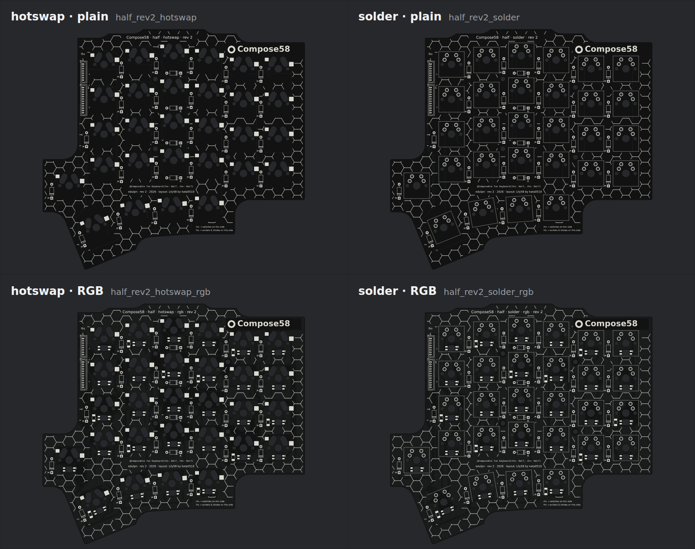
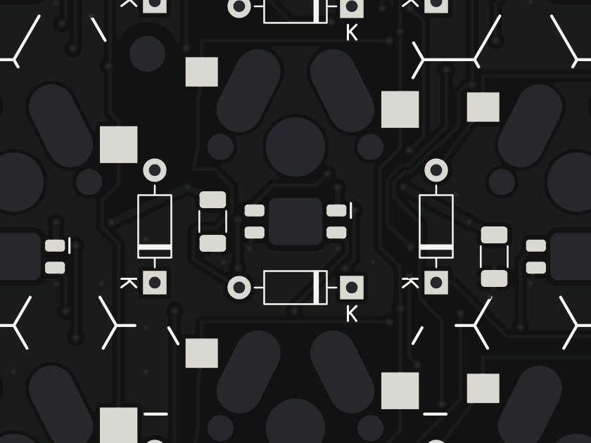

# Rev 2 half boards

[Home](../README.md) › Docs › [Rev 2](rev2.md) › Half boards

One reversible board serves both halves of a keyboard, in four variants. `python3 -m compose half-rev2` builds all four (place, route, DRC, Gerbers; `--plan` draws the placement only). The code is `compose/pcb/rev2_half.py`. A keyboard's own boards, with their figures and check results, are on its page ([Compose58](../layouts/compose58/rev2.md#the-half-boards)).

*Compose58's four boards.*

| board | switches | LEDs |
|---|---|---|
| `half_rev2_hotswap` | Kailh MX hotswap sockets | none |
| `half_rev2_solder` | soldered | none |
| `half_rev2_hotswap_rgb` | Kailh MX hotswap sockets | SK6812 MINI-E under every switch |
| `half_rev2_solder_rgb` | soldered | SK6812 MINI-E under every switch |

Pick hotswap or solder, and RGB or not, the way you'd pick on any keyboard. Order five of the one you want (two per keyboard). An RGB board works without its LEDs and capacitors fitted (the matrix doesn't touch them), so it also keeps the option open: they go on the bottom face, clear of everything else, and can be added later with the board out of the case.

> **The RGB boards are experimental.** They pass the same DRC and copper simulation as the plain boards, but nobody has built one yet. Before you order:
>
> - **LED footprint.** Checked against the OPSCO SK6812MINI-E datasheet (rev 04): the pinout, the pin corners for reverse mounting, the 3.2 × 2.8 mm body and the pad pitch all match. The pads are 1.35 mm long instead of the recommended 1.8, so each lead sits on 0.84 mm of pad. They stop 0.3 mm from the cutout: nearer than the 0.4 mm the rest of the board's copper keeps from an edge, under a DRC rule of their own (JLCPCB's minimum is 0.2 mm). The two published footprints the simulation takes the pinout from start 0.05 and 0.15 mm nearer the LED still. The cutout has no orientation chamfer: orient each LED by the pin 1 mark on the silkscreen.
> - **Power.** The firmware caps brightness at 32/255. Without the cap each LED can draw 36 mA at full white; a 29-key half like Compose58's then draws about 1 A (0.13 A at the cap): more than the controller's 0.5 A polyfuse and USB's 0.5 A allow. (Both connectors' contacts are rated 1.0 A each, two per rail.) Keep the cap.
> - **Decoupling.** There's one 100 nF capacitor per three LEDs (to limit inrush when the keyboard is plugged in), not the one per LED the datasheet suggests. That's fine at the capped brightness.
>
> If you build one, please report what you find.

**On this page:** [Design](#design) · [Cable connectors](#cable-connectors) · [RGB boards](#rgb-boards) · [Firmware](#firmware) · [What the simulation checks](#what-sim-half-rev2-checks)

## Design

- **One reversible board for both halves.** The left half has its switches on the front and everything else on the back; the right half is the same board flipped over.
- **Every one-sided part has a copy on each face**: sockets, LEDs, capacitors. Fit only the copies on the face away from the switches. Through-hole parts (diodes, solder-in switches, the cable connectors) serve both; the cable connectors, too, go on the face away from the switches.
- **One placement for all four boards**: diodes, mounting posts and the connectors sit in the same spots on every variant, so one plate fits them all.
- **Outline:** the plate outline less 5 mm, inside the gasket pads. No case screws go through it: the board hangs from the plate on four M2 screws into heat-set inserts in the plate, placed in column gaps clear of every part. No copper runs within 2.15 mm of a screw's centre on either face, so the screw's head (up to 4 mm across) and the insert's face have no track or pour under them to cut into.
- **Matrix:** the layout's rows and columns, COL2ROW, a through-hole diode per key in the column or row gap beside it. The plate has a shallow pocket over each diode's top-side solder joint.
- **Diode joints on the hotswap boards:** the joint at a diode's switch end can sit close to a socket's column pad: the placement keeps 0.45 mm between them. Solder bridging the two closes a key's circuit without its switch, so that key reads as held down. Keep those joints small and look at each one before the switches go in.

## Cable connectors

- **Connectors:** a Molex PicoBlade 53047-0810 (8 positions) behind a 53047-1210 (12 positions), 1.25 mm pitch, vertical, through-hole, end to end along the inner edge on the face away from the switches, openings facing down into the bay. KiCad's own footprints; the build compares each body outline with the sizes the case checks use and prints both.
- **Where:** their pins are level with the controller's (`conn_row_y_P()` in `compose/pcb/rev2_half.py` reads the row from the controller standard, and each slot sits at the controller's spacing), so the cables run straight across and new angles need no hand-tuning. The bodies sit at least 1.0 mm in from the board edge, and the pins and bodies 0.6 mm from every other part on either face (they're through-hole, and hand-soldered); `sim-half-rev2` checks the gap on the routed copper. If their spot is taken they slide along the row. A body runs 2.05 mm to one side of its pins and 1.15 mm to the other; on the right half (fitted from the other face) it's the other way round, so the placement keeps 2.05 mm clear on both sides.
- **Slot order:** the [controller rev 2](controller-rev2.md#cable-connectors-and-slot-order) order by physical position: the back-most pin is slot 1, on both halves. The 8-pin holds slots 1–8, the 12-pin 9–20. The columns run from the front of the 8-pin: COL0 in slot 8, COL6 in slot 2.
- **Which way round:** the rule is the "1" marks: each cable has to join the controller's "1" to the half's "1", the back-most slot to the back-most slot. A half's connectors fit their pins either way round, and the cable decides which way meets the rule. The square pads (pin 1) are no guide on their own: the controller's connectors fit one way only, opening outward, so their pin 1 is at the back end (at the "1") on the left side but at the front end on the right side. Ready-made PicoBlade cables come in two kinds, *same direction* (pin 1 to pin 1) and *reverse direction* (pin 1 to the last pin), and each half's connector goes on accordingly:

  | cable | left half | right half |
  |---|---|---|
  | same direction | as printed: pin 1 on the square pad, beside the "1" | turned round: pin 1 at the far end from the "1" |
  | reverse direction | turned round | as printed |

  "As printed" puts the housing over its outline on the board; turned round, the same housing sits half a turn round, its wider side across the pins from the outline. An 8-pin and a 12-pin cable can be of different kinds: take each on its own. When you don't know a cable's kind, plug it into the controller before soldering the half's connector and follow the wire from the controller's "1". Fitted the other way, that cable's slots meet in reverse: harmless (the pinout is [reversal-safe](controller-rev2.md#cable-connectors-and-slot-order)), but that half's keys scramble; turning the connector round puts it right.
- **Plug the cables in first:** the connectors are under the board, so the cables go in before the board goes onto its plate.

| slots | signal |
|---|---|
| 1, 9, 20 | GND |
| 2–8 | COL6–COL0 (COL0 in slot 8) |
| 10, 19 | 5 V |
| 11 | RGB data in |
| 12–17 | ROW0–ROW5 |
| 18 | RGB data out |

A layout uses the columns and rows it has (Compose58 leaves COL6 spare, and puts only its inner key on ROW5). The plain boards wire slot 11 straight to slot 18, so the controller's RGB chain still passes through, and leave 5 V and GND unconnected.

The cables: a ready-made 8-pin and 12-pin PicoBlade cable, 150 mm (see the [controller's BOM](controller-rev2.md#bom)).

## RGB boards

| | |
|---|---|
| LED | SK6812 MINI-E, reverse mount, in a cutout under each switch's LED window; soldered on the bottom face, shining up through the board into the switch |
| light | comes out on the near side of each key ("south-facing"): MX switches have their LED window opposite their pins, and the pins point away from you. Any MX switch with an LED window works; sockets and LEDs never share a side. |
| chain | one per half, in the order the placement gives it (Compose58: up the outer column, down the next and so on, then the inner key and the thumb arc from the inside out) |
| capacitors | 100 nF 1206 beside every third LED (10 per half on Compose58) |
| power | 5 V from slots 10/19, GND from slots 1/9/20 |
| 5 V rail | autorouted, unless the layout lays it out by hand (`layouts/<name>/preroute.py`, see [Routing](building.md#routing)). `sim-half-rev2` reads its resistance from the routed copper, from the connector to the farthest LED, and the return's through the GND pour (both faces, with the pads' stubs and vias) from the worst LED's GND pad back to slots 1, 9 and 20. For a rail laid by hand, the worst rail and the worst return together are held to 150 mΩ, the figure the controller's power simulation allows a half. The figures include 20 % for temperature and plating tolerance. |
| GND | a copper pour on both faces, stitched with vias. Every SMD GND pad (LEDs, capacitors, connector) has its own via on a short stub, placed before routing, so the pour reaches it on both faces whatever the tracks do around it. (With every pad doubled for both halves, GND as tracks didn't fit on two layers.) |

## Firmware

`python3 -m compose firmware-rev2` writes:

| file | for |
|---|---|
| `firmware/keyboard.json` | plain boards |
| `firmware/rgb/keyboard.json` | RGB boards: RGB Matrix, an LED per key, brightness capped at 32 |

Both use the controller rev 2 pin map: a 6 × 14 matrix, left keys at their own row and column, right keys at column 13 − col. CI validates both files against QMK's own schema (`.github/ci/qmk_schema.py`). A QMK build needs a keymap as well: put the file in a keyboard folder of your QMK tree with a `keymaps/default/keymap.json` beside it (the layout is `LAYOUT`).

**The brightness cap** (RGB boards) is QMK's `RGB_MATRIX_MAXIMUM_BRIGHTNESS`. QMK applies it when brightness is set through its own keycodes and functions, and nowhere else:

- a Pico that ran other RGB firmware keeps the brightness it stored. Clear its stored settings once: press a key mapped to `QK_CLEAR_EEPROM`, or flash Raspberry Pi's `flash_nuke.uf2` before the firmware;
- keymap code that sets colours itself (`rgb_matrix_set_color()`) is not capped: keep those values at 32 or under.

Past the cap each LED can draw up to 36 mA (2.1 A for Compose58's 58); the controller's polyfuse then cuts the LED rail.

## What `sim-half-rev2` checks

`python3 -m compose sim-half-rev2` rebuilds each board's netlist from its copper alone and fits the parts as a builder would, the left half one way up and the right half flipped. For each board and both halves it checks:

- every key runs column slot → switch → diode → row slot;
- spare slots stay unconnected;
- a diode's solder joint at least 0.45 mm from the pad of every other net on its face;
- no copper of any net within 2.15 mm of an M2 hole's centre, on either face (under the screw's head and the plate's insert);
- RGB boards: one unbroken LED chain from slot 11 to slot 18, with every LED and capacitor across 5 V and GND;
- RGB boards: the 5 V rail and the return through the GND pour, each read from the copper, within 150 mΩ together;
- RGB boards: the LED data run into the half and out of it within the lengths the controller's circuit simulation sweeps (200 and 300 mm of track);
- RGB boards: LED data tracks beside column and row tracks move no column or row more than 0.7 V, with every data net switching at once;
- RGB boards: the firmware lists its LEDs in the chain's order, the left half's then the right's;
- plain boards: the RGB pass-through.

Then it joins each half to the controller through model cables, slot k to slot k (both ends number their slots by physical position), and scans end to end with QMK's COL2ROW scan, through the real controller rev 2 copper: every key alone at its keymap position, 1000 random chords exact, no ghosting. Negative controls (a cut column, a diode fitted backwards, a reversed cable) are caught.
