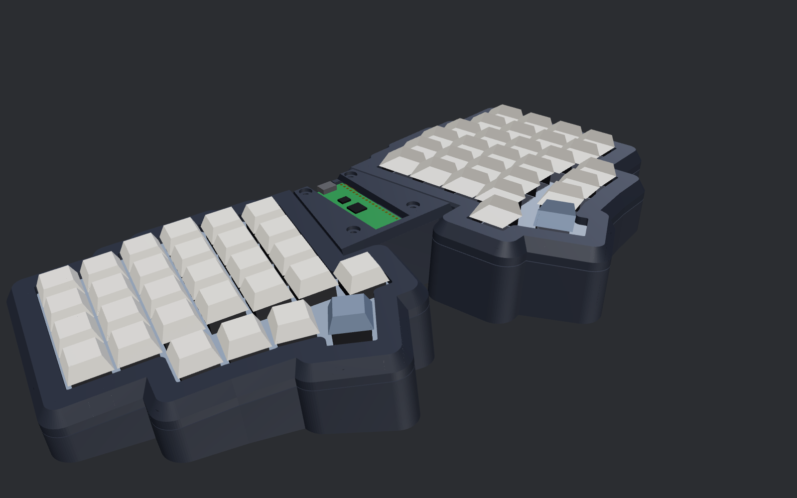
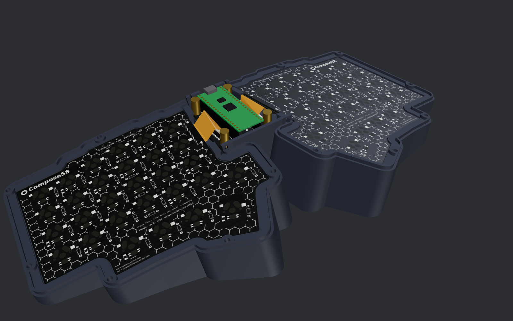
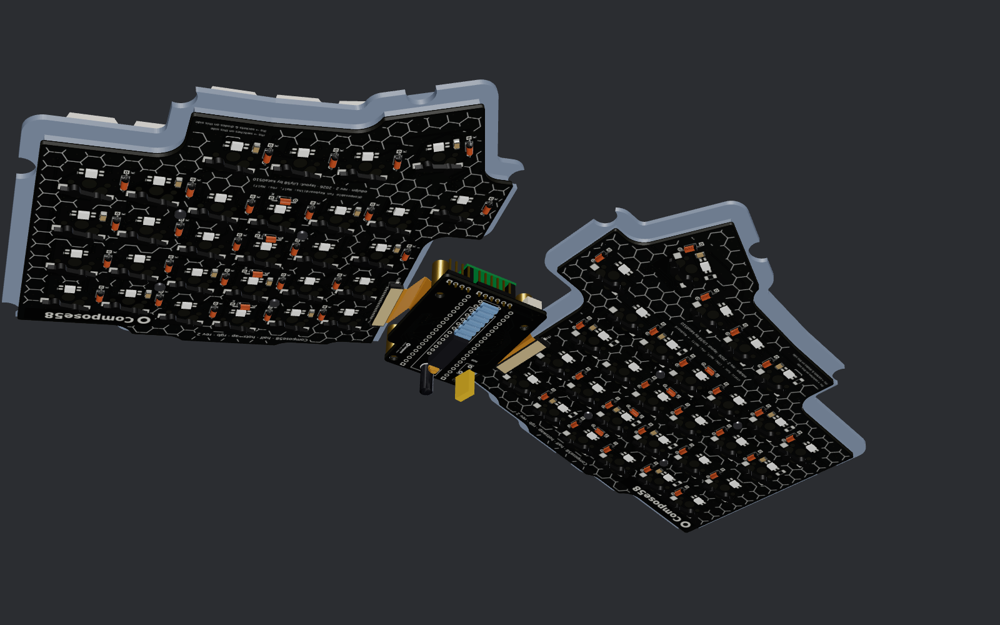
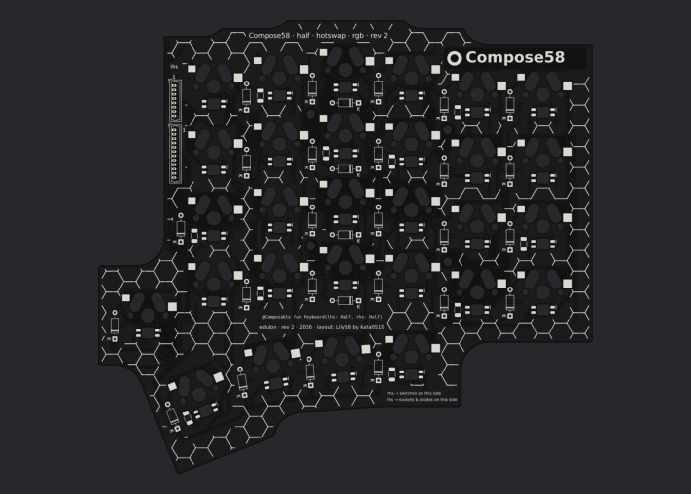

# Compose58 rev 2

[Compose58](README.md) › rev 2 · **Status: in progress.** The case, cover, controller and half boards are designed and checked; nothing is built yet.

| | rev 2 |
|---|---|
| **Case** | one-piece tub, gasket-mounted plates, bevelled frames, lift-off middle cover |
| **Controller** | the shared [controller rev 2](../../docs/controller-rev2.md) (socketed Pico, an 8-pin and a 12-pin PicoBlade cable per half) |
| **Half boards** | one reversible board for both halves, in four variants: hotswap or solder, with or without per-key RGB |
| **Cables** | ready-made PicoBlade (MX1.25) cables, an 8-pin and a 12-pin per half, 150 mm |
| **Angles** | splay 14°, tent 6°, tilt 0° |
| **Hardware** | M3 screws and heat-set inserts; M2 for board to plate |

**How rev 2 works** is on the platform's pages: [rev 2](../../docs/rev2.md) · [the gasket-mount case](../../docs/gasket-case.md) · [controller rev 2](../../docs/controller-rev2.md) · [half boards](../../docs/half-boards-rev2.md) · [building from source](../../docs/building.md). This page is what Compose58 gets from them: its sizes, its parts and what its checks returned.

**On this page:** [The case](#the-case) · [The half boards](#the-half-boards) · [Firmware](#firmware)

## The case

How it works: [the gasket-mount case](../../docs/gasket-case.md).

| | |
|---|---|
| tub | one print, 346 × 167 mm |
| pads | 20 pairs per half: 18 found along the plate edge, 2 at the ends of the inner (bridge) edge |
| frame screws | six M3 per frame |

### Checked (`gasket-checks`: 150 checks, all passing)

| check | result |
|---|---|
| layout | 29 keys per half, keycaps at least 0.5 mm apart; the inner edge straight along the whole centre section |
| overlaps | none between parts that mustn't touch: tub, plates, frames, cover, controller board and the parts on both its faces, Pico stack, standoffs, the real underside parts of every half-board variant, the mated cable plugs, pads |
| clearances | plate–tub 0.6 mm, plate–frame 0.6 mm, cover–frames 0.3 mm, board–tub 0.5 mm, Pico–cover 0.7 mm |
| pad gap | 2.10 mm at every pad, top and bottom, measured on the solids along the plate normal |
| assembly paths | plates and frames drop in along the plate normal; the controller and the cover drop straight down |
| hardware | cover screws 2.95 mm into the standoffs, standoff threads 4.4 mm into the inserts; Pico gap 0.96 mm, header plugs under the cover |
| cables | room for each mated plug and its cable's first bend at both ends: at the controller 0.62 mm from the half boards and 1.73 mm from the case, under the halves 2.73 mm from the case |
| printability | every part sliced at 0.2 mm in print orientation; each layer rests on the one below within 45°, with no step wider than one 0.45 mm extrusion line. The exceptions are short bridges over hole ceilings and the 12 frame-screw seats: flat shoulders for the M3 heads, which the tent tilts so each layer exposes a thin crescent, inside the counterbore. A plate with the flange halfway up its edge, the earlier design, fails this. |

### Hardware (case)

| part | qty |
|---|---|
| M3 × 6 button-head screws (12 for the frames, driven up from under the case through the bosses; 4 for the cover) | 16 |
| M3 × 5 × 4 heat-set inserts (12 in the frames, 4 in the controller posts) | 16 |
| M3 × 12 male–female hex standoffs, 5 or 5.5 mm across flats (controller) | 4 |
| foam weatherstrip tape, closed-cell EPDM/neoprene, self-adhesive, 1/8″ × 3/8″ (3 × 10 mm), ~0.4 m | 1 roll |
| rubber bumpons, 10 mm | 8 |

## The half boards

How they work: [rev 2 half boards](../../docs/half-boards-rev2.md).

| boards in the case (plates off) | underside, case off: half boards on their plates, the controller between them |
|---|---|
|  |  |

*Renders from `gasket-render`: the boards wear their own Gerbers, and every part sits where its footprint is on the routed board.*

| | |
|---|---|
| keys | 29 per half; COL6 of the connectors is spare. The inner key (beside the inner column) is on ROW5 and COL5, so it joins the inner column and its row leaves from the connector's front end, beside it. |
| LEDs, capacitors (RGB boards) | 29 and 10 per half; 0.13 A per half at the brightness cap, about 1 A without it |
| connectors | their pins level with the controller's, the row centred 1.45 mm forward of its Pico centre |
| routing | Freerouting 2.5.0 on all four boards; the solder RGB board with seed 3, the hotswap RGB board with seed 13 ([Routing](../../docs/building.md#routing)) |
| diode joints, hotswap boards | 0.46 mm from a socket's column pad at the nearest; 33 joint-and-pad pairs within 1.5 mm, counting both faces. Keep those joints small and look at each one before the switches go in. None within 1.5 mm on the solder boards. |

### Laid out by hand

What [`preroute.py`](preroute.py) lays before the autorouter runs: ROW4 (the thumb row) and ROW5 (the inner key's row, beside ROW4 down the inner edge) on all four boards, and:

| | |
|---|---|
| 5 V rail, RGB boards | a 0.5 mm trunk along every key row, between each switch's centre hole and its LED cutout, with a spur to each LED and capacitor (a via where the pad is on the back). Under a key the trunk is on the front copper; it crosses each column gap on the back, so both faces keep room for what has to cross a row. The rows are tied into a mesh by a 1 mm spine down the outer edge and a 0.8 mm one down the inner edge; slot 10 feeds the top row (up the connectors' cable side, so the columns leaving slots 2–8 have the inboard side to themselves), slot 19 the second row and the inner spine. `sim-half-rev2` reads its resistance from the routed copper: from the connector to the farthest LED, 79 mΩ as the left half and 74 mΩ as the right on the solder RGB board, 80 and 75 mΩ on the hotswap RGB board. It reads the return too, through the GND pour (both faces, with the pads' stubs and vias) from the worst LED's GND pad back to slots 1, 9 and 20: 13 and 12 mΩ on the solder RGB board, 22 and 31 mΩ on the hotswap RGB board, or 37 and 36 mΩ: Freerouting 2.5.0's last pass finishes that board one of two ways, and the GND pour comes out a little different ([Routing](../../docs/building.md#routing)). The worst rail and the worst return together are held to 150 mΩ, the figure the controller's power simulation allows a half; the most is 106 mΩ (hotswap RGB, right half) on the one finish and 118 mΩ (left half) on the other. All of these figures include 20 % for temperature and plating tolerance. |
| D nets, hotswap RGB board | each key's socket pad on either face to its diode. The sockets' pads sit on both faces, so every key needs two links across the board (D and its column), and with the rail laid as well the autorouter didn't finish the board. Each D net runs from the pad beside the diode straight to the diode on that pad's face, and on over the top of the switch to a via above the other pad. The columns, the rows and the LED data are left to the autorouter (Freerouting 2.5.0, see [Routing](../../docs/building.md#routing)). |

### Checked

| check | result |
|---|---|
| DRC, all four boards | 0 errors, 0 warnings, 0 unconnected (the unconnected count also proves the GND pour reaches every GND pad) |
| `sim-half-rev2`, all four boards | passing |
| case checks | the real underside parts of every variant at once, and the mated cable plugs |
| connector gap | the cable connectors' pins ≥ 0.6 mm from every other part's pads on their face, both halves |
| plate | its M2 inserts and diode pockets come from the shared placement, so one plate fits all four boards |

What `sim-half-rev2` checks, and how: [the half boards page](../../docs/half-boards-rev2.md#what-sim-half-rev2-checks).

### Parts (per half)

| part | qty |
|---|---|
| half board (one of the four above) | 1 |
| Kailh MX hotswap sockets (hotswap boards) | 29 |
| 1N4148 diodes, DO-35 | 29 |
| Molex PicoBlade 53047-0810 (8 pos, vertical) and 53047-1210 (12 pos, vertical) | 1 + 1 |
| PicoBlade (MX1.25) cables, 150 mm, ready-made, female at both ends: 8-pin and 12-pin | 1 + 1 |
| M2 × 4 screws + M2 heat-set inserts (board to plate; 2.4 mm of thread in the insert) | 4 + 4 |
| *RGB boards:* SK6812 MINI-E | 29 |
| *RGB boards:* 100 nF 1206 capacitors | 10 |

## Firmware

`python3 -m compose firmware-rev2` writes `firmware/keyboard.json` for the plain boards and `firmware/rgb/keyboard.json` for the RGB boards: 58 keys, and on the RGB boards 58 LEDs with the brightness capped at 32. What the cap covers and how to build with it: [firmware](../../docs/half-boards-rev2.md#firmware).
