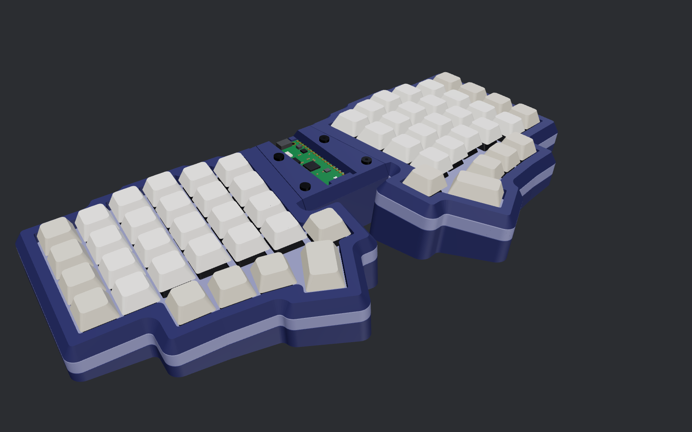
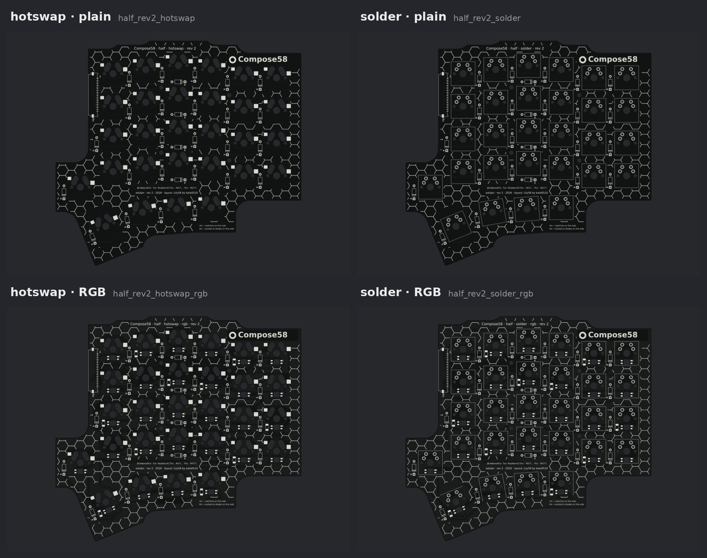

# Compose58

[Home](../../README.md) › Layouts › Compose58

A unibody, tented and splayed keyboard on the [Lily58](https://github.com/kata0510/Lily58) key layout by kata0510.

## Revisions

| Revision | Case | Controller | Status | Files |
|---|---|---|---|---|
| **[rev 1](rev1.md)** | One-piece, screwed sandwich mount | rev 1: Pico + 12-pin PicoBlade cables | **Built.** Assembled and wired; the final cable test is pending | [Release `compose58-rev1`](https://github.com/edulpn/compose-keyboards/releases/tag/compose58-rev1) |
| **[rev 2](rev2.md)** | One-piece, gasket mount (foam weatherstrip pads) | [rev 2](../../docs/controller-rev2.md): Pico + 20-pin flex jumpers, optional RGB, I2C/Qwiic/AUX | **In progress.** Case, cover, controller, all four half boards and the flex jumper designed and checked; not built yet | — |

*Rev 2's half board in its four variants: hotswap or solder, with or without per-key RGB (experimental).*

## At a glance

- **Keys:** 58. Per half: 6 × 4 column-staggered, a 4-key thumb arc with one 1.5u key, and one extra inner key.
- **Shape:** one piece. The halves are splayed 10° and tented (6° on rev 1, 12° on rev 2), with the controller in a bridge between them.
- **Boards:** one reversible half board for both halves, in hotswap or solder-in versions (rev 2 adds optional per-key RGB), plus the controller.
- **Firmware:** QMK on the RP2040. `keyboard.json` is generated with the boards.
- **Printer:** the case is a single print of about 330 × 160 mm, sized for a 350 mm bed (a Voron Trident 350, for example).

## Pages

- **[Rev 1](rev1.md):** the build guide.
  - Connectors and cables, including what to buy and the 1:1 cable trap.
  - Assembly order, PCBs, the controller rev 1 interface.
  - What the checks verify, print orientation.
- **[Rev 2](rev2.md):** the gasket-mount case, the half boards (hotswap or solder, with or without per-key RGB), the flex jumpers, the checks and simulation, and the design notes and ideas collected along the way.
- **[Controller rev 2](../../docs/controller-rev2.md):** the shared controller rev 2 uses.
- **[Building from source](../../docs/building.md):** changing angles or parameters and regenerating everything.

## Files

- **`layout.py`:** the left half's keys in its own frame, plus the sandwich screws, plate posts and feet. The right half is the mirror image.
- **Releases:** ready-to-use STLs, JLCPCB Gerbers, `keyboard.json` and the BOM for each revision's recommended configuration. Tags start with `compose58-`.

## Credits

The key layout is the Lily58's, by kata0510 (Naoki Katahira), MIT licensed; see [NOTICE.md](../../NOTICE.md). Only the layout is used: the case, boards and firmware here are generated by the Compose platform.
