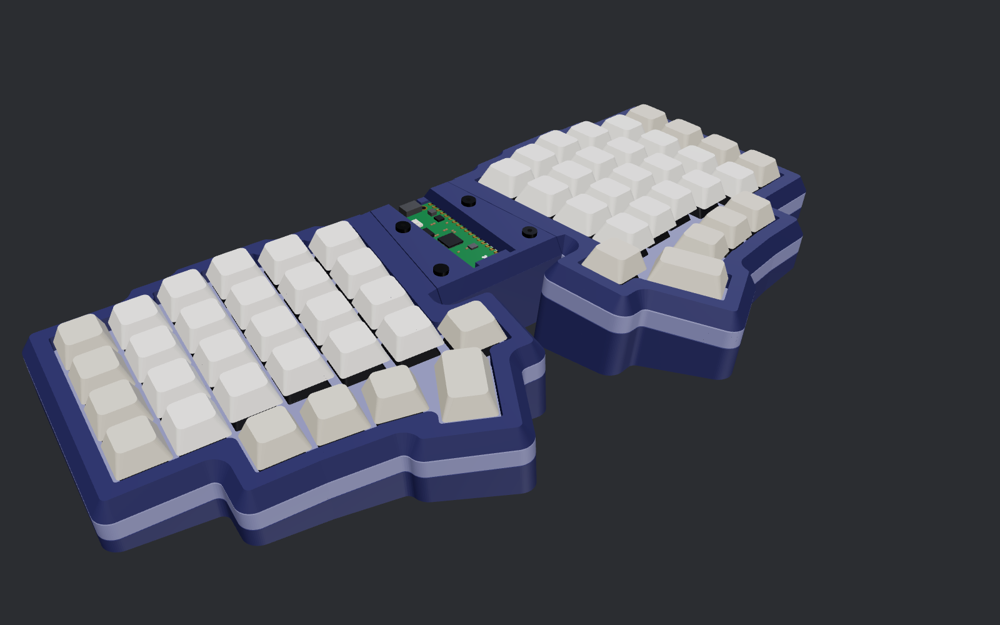
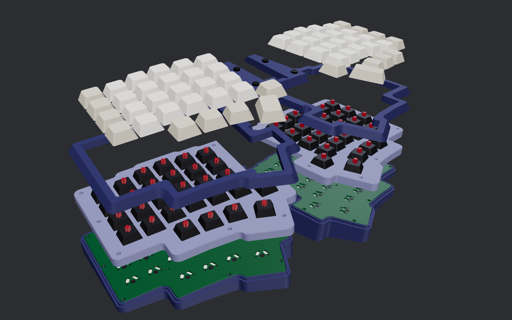
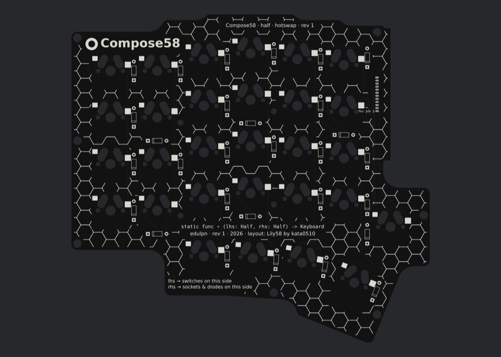

# Compose58 rev 1

[Compose58](README.md) › rev 1 · **Status: built** · Release: `compose58-rev1`

A one-piece tented, splayed case with a screwed sandwich mount (case boss → half board → plate → frame), reversible half PCBs (hotswap or solder-in) and controller rev 1: a Raspberry Pi Pico in sockets, wired to the halves with 12-pin PicoBlade cables.



| exploded, in install order | half board |
|---|---|
|  |  |

- **Switches:** MX-style. The build used Box Pink.
- **Diodes:** 1N4148 through-hole, COL2ROW.
- **Matrix:** two ways to build it, chosen by `MATRIX` in `compose/params.py`:
  - **`"pcb"` (default):** a reversible half PCB plus a controller PCB. The half PCB comes in two versions, hotswap or solder-in.
  - **`"handwire"`:** bare copper wire with the Pico on a perfboard carrier.

  The case, plate and checks follow the mode you pick.

**On this page:** [Build commands](#build-commands) · [PCBs, connectors and cables](#pcbs-matrix--pcb) · [Controller rev 1 interface](#controller-rev-1-interface-keep-it-compatible) · [What the checks verify](#what-the-checks-verify) · [Print orientation](#print-orientation)

## Build commands

From the repo root (requirements: [Building from source](../../docs/building.md)):

```
python3 -m compose build out      # parts → out/print, out/step (incl. assembly.step), out/world, out/bom.txt   (~50 s)
python3 -m compose model out      # switches, wiring, Pico etc. for checks/renders → out/render
python3 -m compose checks out     # fit, assembly and print checks; exit 1 on failure                   (~40 s)
python3 -m compose render out     # PNGs → out/png  (needs node + playwright; cross-sections need only matplotlib)
python3 -m compose pcb out        # PCBs → out/pcb: KiCad boards, DRC reports, *_JLCPCB.zip, previews
                                  #   needs KiCad 7 (pcbnew), Java 21+, and freerouting.jar (github.com/freerouting/freerouting releases)
                                  #   at ../tools/freerouting.jar or set FREEROUTING=/path/to/jar
python3 -m compose firmware out   # QMK keyboard.json for the PCB build → out/firmware
python3 -m compose sim out        # electrical simulation of the routed boards + firmware pins (~10 s)
```

## PCBs (MATRIX = "pcb")

There are three designs, all 2-layer and 1.6 mm. Each one routes until KiCad's DRC shows 0 errors and 0 unconnected nets.

| Design | What it is | How many to order |
|---|---|---|
| `half_hotswap` | Reversible half board with Kailh MX hotswap sockets | 5 (makes 2 keyboards + a spare) |
| `half_solder` | The same board with plated holes; switches soldered in | 5 (makes 2 keyboards + a spare) |
| `controller` | Socket for the Pico (two 20-pin female headers) and two cable connectors. Replaces the perfboard carrier: same screws, same height. | 5 |

Upload `out/pcb/<name>_JLCPCB.zip` to JLCPCB as-is. Default options are fine (HASL, any colour).

**Building the reversible boards.**
- Left half: switches go in from the side labelled "LEFT: switches this side". Sockets, diodes and the connector go on the other side.
- Right half: flip the board over and do the same from the side labelled "RIGHT".
- Every switch footprint carries both pin patterns, so the switch fits from either face. On the hotswap board, the socket pads exist on both faces too.
- Diode cathode band: the silkscreen on each face shows which way it goes.

**Soldering order (hotswap board).** Solder the Kailh sockets first and the diodes second. With the diodes in, the socket pads are much harder to reach with the iron. Done this way, a half takes about 20 minutes.

**Connectors.** Molex PicoBlade, 1.25 mm pitch, 12 positions:
- **Half boards: 53047-1210, straight (vertical).** Fit it on the face opposite the switches, opening down toward the case floor. Pin 1 goes in the hole marked "lhs: pin 1" on the left half and "rhs: pin 1" on the right half.
- **Controller: 53048-1210, right angle.** Fit it on top, openings facing outward toward the halves.
- **Don't use right-angle headers on the half boards.** They drop into the same holes with the same pinout, but the mated plug sticks out past the half board's inner edge. It then lands nose to nose with the controller's connector about 3 mm away, and next to a cover-screw post. The straight header sends the plug down, and the case is laid out for that.
- Changing a header after soldering: cut the old one's pins at the body and pull the stubs one by one. Clear the 0.5 mm holes with flux and wick, then a stainless needle pushed through while the pad is hot. Solder doesn't stick to stainless.

**Cables.** Two 12-position PicoBlade double-ended cables (housings 51021-1200), wired **1:1, pin 1 to pin 1**. Both cables are identical; the controller handles the right half's flipped board. About 150 mm long: that leaves room to plug the half in while holding the plate above the case, and still tucks into the bridge.
- **Ready-made:** Molex 15134-12xx (-1201 = 100 mm, -1202 = 150 mm), or the generic "PicoBlade 51021 / MX1.25" double-ended cables, 12P.
- **Sellers' naming is inconsistent.** On one AliExpress listing "same direction" means 1-1, 2-2, 3-3. On Conbeone's, "Type A, 双头同向 (same direction)" is drawn Pin 1 → Pin N, which is reversed; their "Type B, 双头反向" is the 1:1 one. Go by the pin diagram, never the name.
- **How to tell by eye:** laid flat end to end with straight wires, a 1:1 cable has its two latches on opposite sides. If both latches face the same way with straight wires, it's reversed. Either way, meter it before plugging in: pin 1 should beep to pin 1, with no shorts between neighbours.
- **Crimping your own:** terminals Molex 50079-8000 (26–28 AWG). Look at each housing from the wire side with the latch up, and put each wire in the same cavity position at both ends. Filling all 12 cavities avoids having to identify pin 1 (the 12th wire is GND on the controller and unconnected on the half). A fine-jaw crimper such as the Engineer PA-09 makes these terminals manageable.
- **Direct wiring (no connectors)** also works electrically: 11 wires of 28 AWG, about 100 mm, from each half's connector holes to the controller's, in order. The half's ROW0 hole is "lhs: pin 1" on the left half. On the right half it's the end opposite "rhs: pin 1", which is the unconnected hole. In practice, keeping the small holes clear of solder while pushing wires in is fiddly, which is why the rev 1 build moved to connectors.

**Pico cover pad.** The foam pad on the cover's clamp tab is optional. With the Pico seated in a snug socket, the 0.8 mm gap under the cover is too small for it to creep out.

**Assembly order.**
1. Screw the controller board onto its posts and fit the Pico.
2. Plug each cable into the controller.
3. Plug each cable into its half board from below, while holding the plate (with the half board under it) above the case.
4. Lower the plate straight in.
5. From under the case, drive the M2×6s up through the middle posts and the board into the plate's inserts.
6. Fit the frames. From under the case, drive each M3×14 up through the case boss, the board and the plate into the frame's insert. Tighten fully.
7. Fit the cover.

**What PCB mode changes elsewhere.**
- **Sandwich mount.** Rev 1 is screwed solid. At the perimeter, each M3 clamps case boss → half board → plate → frame. In the middle, M2 screws come up through the case posts and the board into the plate. The bosses stop 1.6 mm lower to make room for the board, and the sandwich screws come out to M3×14.
- The plate gets 1.2 mm pockets on its underside over the top-side solder joints (diode leads, connector pins).
- Space under the plate drops to what the sockets need, so the case is 2 mm lower.
- The plate support posts are placed automatically (`compose/pcb/layout.py`, `solve_posts`). Each post lands where the case post's contact ring clears every socket, socket pad, pin and connector on both faces of the board.

**Electrical simulation (`python3 -m compose sim`, `compose/sim/matrix.py`).** It doesn't trust the net names in the design. It:
- rebuilds connectivity from the routed copper geometry;
- places real parts where a builder would put them: switch pins, Kailh tabs at their nominal positions, diodes by the band, the connector by its pin-1 label, a straight cable and the Pico's datasheet pinout;
- builds the right half flipped;
- runs QMK's COL2ROW scan with the pins from `keyboard.json`.

It checks:
- every key reads at its own matrix position;
- 600 random chords show no ghosting;
- no GPIO is shorted.

Negative controls prove it would catch a reversed connector, swapped firmware pins, missing mirrored pads and reversed diodes.

**Board art (`compose/pcb/art.py`).** All free with standard HASL; only gold (ENIG) would cost extra.
- **Exposed-copper title on both faces:** the ∘ logo and "Compose58" as bare tin under a soldermask opening, so it reads silver on a black board. Traces are kept out of that area during routing.
- **Silkscreen tagline:** Swift on one face (`static func ∘ (lhs: Half, rhs: Half) -> Keyboard`), Kotlin Compose on the other (`@Composable fun Keyboard(lhs: Half, rhs: Half)`).
- **Credit line:** "edulpn · rev 1 · 2026 · layout: Lily58 by kata0510".
- **Build labels:** lhs and rhs on each face.
- **Hex lattice:** echoes the case floor, filling the free space.

Name, handle, taglines and lattice size are set in `compose/params.py`.

**Firmware.** `out/firmware/keyboard.json` is a QMK definition.
- Controller: RP2040, COL2ROW.
- Matrix: 10 rows × 12 columns, with the left half at `[row, col]` and the right half at `[5+row, 6+col]`.
- Pins:
  - Left: rows GP0–4, columns GP5–10.
  - Right: rows GP15–19, columns GP20–22 and GP26–28.
- These pins are chosen so that no traces cross on the controller board.

## Controller rev 1 interface (keep it compatible)

The controller board, its wiring and the firmware pin map are a fixed interface. Any future half-board layout should plug into the same controller and wiring and reuse the same firmware configuration.

- **Connector positions on each half board:**
  - positions 1–5: ROW0–ROW4;
  - positions 6–11: COL0–COL5;
  - position 12: not connected on the half. It's GND on the controller.
- **Numbering:** positions are counted as a straight cable sees them. On the right half (the board flipped), the controller handles the mirroring.
- **Controller pins:**
  - Left: rows GP0–4, columns GP5–10.
  - Right: rows GP15–19, columns GP20, 21, 22, 26, 27, 28.
- **Firmware matrix:** 10 × 12, with the left half at [row, col] and the right half at [5 + row, 6 + col].
- **Key limit:** up to 5 × 6 = 30 keys per half fit without touching the controller or the pin map. A new layout only changes which matrix positions are used, plus the keymap and layout in `keyboard.json`.
- **In code:** `half_nets()` and `LEFT_GPIO` / `RIGHT_GPIO` in `compose/pcb/layout.py` define this interface. `compose/sim/matrix.py` verifies it against the routed copper, so it catches a layout that breaks it.
- **Going beyond 30 keys per half,** or changing the connector, means a new controller revision. Treat it as a breaking change and version it.

## What the checks verify

- Every printed part is a closed single body.
- There is no overlap in the assembled position.
- Switches, wiring, Pico, headers, screws and keycaps don't penetrate printed parts. Wires keep at least 0.8 mm from the case.
- Keycaps clear the frames, cover and case both at rest and pressed through the full 4 mm of travel. The stem height comes from the Cherry MX 3D model.
- The assembly sweeps pass, along with their negative controls.
- A hex key reaches every screw.
- No overhang wider than about 11 mm in print orientation.
- Every part fits the bed.

## Print orientation

- **case:** floor down. It's a one-piece print at 329 × 154 mm.
- **plates:** switch side down, so the lip prints upward.
- **frames and cover:** underside down.
