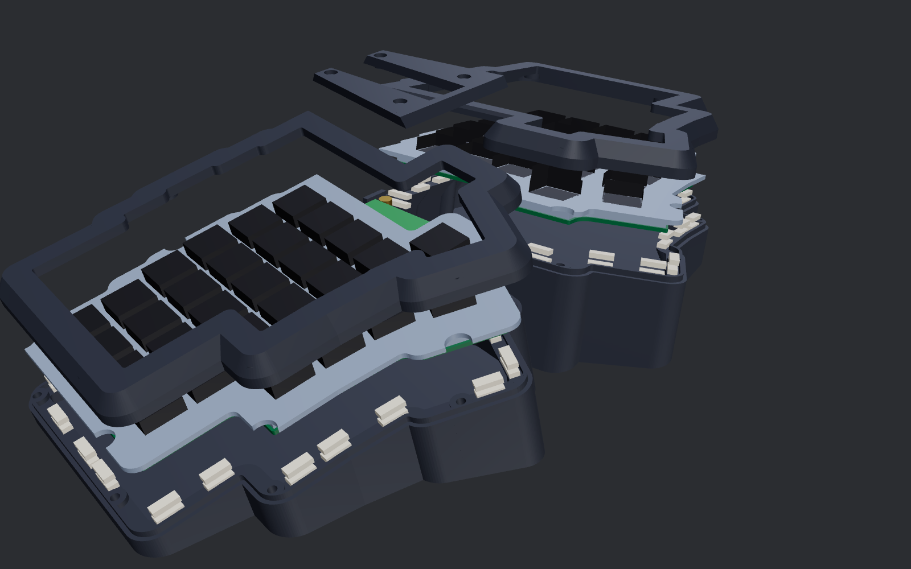
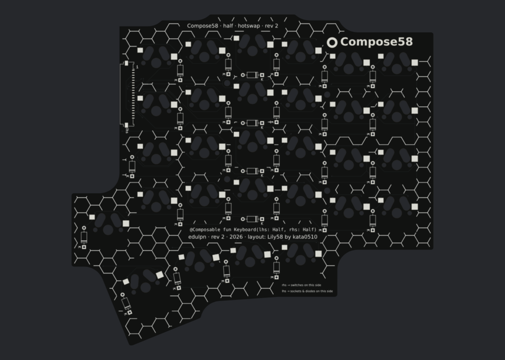

# Compose58 rev 2

[Compose58](README.md) › rev 2 · **Status: in progress.** The case, cover, controller and half boards are designed and checked; nothing is built yet.

**On this page:** [The rev 2 case](#the-rev-2-case-gasket-mount) · [The rev 2 half boards](#the-rev-2-half-boards) · [Design notes and ideas](#design-notes-and-ideas)

## The rev 2 case: gasket mount

`compose/case/gasket.py` builds the rev 2 parts: `C58_REV=2 python3 -m compose gasket-case out_r2t`. `gasket-checks` checks them, `gasket-sections` draws cross-sections and `gasket-render` renders them (all with `C58_REV=2`). Rev 1 is untouched (`C58_REV` defaults to 1).

The controller is the shared [controller rev 2](../../docs/controller-rev2.md).

- **Defaults:** splay 10°, tent 12°, tilt 0° (from the ergonomics research, provisional until the angle test prints are tried), 62 mm bridge with 2.5 mm end walls. Every angle still overrides with `C58_SPLAY` / `C58_TENT` / `C58_TILT`.
- **Parts:** one tub (both halves and the open middle bay, one print, 332 × 161 mm on the 350 mm bed), two plates, two frames, the middle cover. `C58_REV=2 python3 -m compose gasket-case out_r2t` writes them to `out_r2t/print/` in print orientation, all printable without supports:
  - tub: on its floor; the pad ledge steps back to the wall at 60° underneath instead of hanging off it;
  - plates: switch side down, as on rev 1, so the flange (flush with the top face) lies flat on the bed and the switch-clip pockets open upward;
  - frames and cover: upside down, visible tops on the bed (their bevels are 56° from the bed).
  Every mesh is checked watertight with no non-manifold edges, and sliced layer by layer for overhangs (see the checks).
- **Look:** rev 1's bevelled frames (6 mm tall, 4 mm inset) and reveal line over the tub's top edge; the outer corners are rounded at 4.5 mm so the bevel stays clean all the way round.
- **Gasket mount:** each plate is a 5 mm core holding the switches plus a thin 2 mm flange round its edge, flush with the plate's top face. The flange is pinched between foam pads: pads on a ledge in the tub below, pads under the frame above. Nothing screws through the plate or the half board. Each frame screws to the tub from below with six M3 screws into heat-set inserts and bottoms out on the tub's bosses, so the squeeze is set by geometry, not by how hard the screws are tightened. The plate floats 0.6 mm clear of the walls and frame sideways.
- **Pads = ordinary foam weatherstrip tape.** Self-adhesive closed-cell EPDM or neoprene sponge, 1/8″ (3 mm) thick, 3/8″ or 10 mm wide, cut across into 4 mm slices with scissors. The pads are 10 mm along the edge and 4 mm inward, stuck to the ledge and to the frame's underside. They are installed at 2.1 mm, which is 30–34 % squeeze for 3.0–3.2 mm tape (that foam is happy at 25–50 %). There are 20 pad pairs per half: 18 found by scanning the plate edge for every spot where a slice fits between the plate edge and the half board, plus one pair at each end of the inner (bridge) edge on seats that stand straight up from the floor, so they don't lean into the controller.
- **Middle bay:** the controller sits on four floor posts (M3 inserts) and is clamped by its four M3 standoffs; the cover drops onto the standoffs and takes four M3 × 6 screws, so it comes off without touching the ribbons. The bay is open from wall to wall below the plates' inner edges, so the ribbons run straight out from the board's side edges to the halves. There are 24 mm under the board.
- **Checked (`gasket-checks`, all passing):**
  - no overlap between any two parts that mustn't touch (tub, plates, frames, cover, controller board and the parts on both its faces, Pico stack, standoffs, half-board proxies, pads);
  - clearances: plate to tub 0.6 mm, plate to frame 0.58 mm, cover to frames 0.3 mm, board to tub 0.5 mm, Pico to cover 0.7 mm;
  - the pad gap measured on the solids along the plate normal at every pad (2.10 mm everywhere, top and bottom);
  - assembly paths: plates and frames drop in along the plate normal, the controller and the cover drop straight down;
  - hardware engagement: cover screws 2.95 mm into the standoffs, standoff threads 4.4 mm into the inserts; Pico gap 0.96 mm, header plugs under the cover;
  - printability: each exported part is sliced at 0.2 mm in its print orientation and every layer must rest on the one below within 45°. Short bridges over hole ceilings and lips up to 1.2 mm are allowed. A plate with the flange halfway up its edge (the earlier design) fails this check.
- **Ribbons:** each half's 20-pin FFC hangs in a U in the bay between the controller and the half (below). The checks model it at its real length, including the twist that takes up the splay, and keep it clear of everything.

**Rev 2 hardware (case)**

| part | qty |
|---|---|
| M3 × 6 button-head screws (12 for the frames, driven up from under the case through the bosses; 4 for the cover) | 16 |
| M3 × 5 × 4 heat-set inserts (12 in the frames, 4 in the controller posts) | 16 |
| M3 × 12 male–female hex standoffs, 5 or 5.5 mm across flats (controller) | 4 |
| foam weatherstrip tape, closed-cell EPDM/neoprene, self-adhesive, 1/8″ × 3/8″ (3 × 10 mm), ~0.4 m | 1 roll |
| rubber bumpons, 10 mm | as rev 1 |

## The rev 2 half boards

`compose/pcb/rev2_half.py` builds four boards: `C58_REV=2 python3 -m compose half-rev2 out_r2t` (place, route, DRC, Gerbers; `--plan` draws the placement only).

| board | switches | LEDs |
|---|---|---|
| `half_rev2_hotswap` | Kailh MX hotswap sockets | none |
| `half_rev2_solder` | soldered | none |
| `half_rev2_hotswap_rgb` | Kailh MX hotswap sockets | SK6812 MINI-E under every switch |
| `half_rev2_solder_rgb` | soldered | SK6812 MINI-E under every switch |

Pick hotswap or solder, and RGB or not, the way you'd pick on any keyboard; order five of the one you want (two per keyboard).

- **One reversible board for both halves**, as on rev 1. The left half has its switches on the front and everything else on the back. The right half is the same board flipped over. Every part that sits on one face has a copy on each face (sockets, LEDs, capacitors, the cable connector); fit only the copies on the face away from the switches. Through-hole parts (diodes, solder-in switches) serve both.
- **Outline:** the plate outline less 5 mm, inside the gasket pads. No case screws go through it: the board hangs from the plate on four M2 screws into heat-set inserts in the plate, placed in column gaps clear of every part.
- **Matrix:** the layout's rows and columns, COL2ROW, a through-hole diode per key in the column or row gap beside it. The plate has a shallow pocket over each diode's top-side solder joint.
- **Cable connector:** a Molex 200528-0200 (20 positions, 1.0 mm pitch, bottom contact) on the bottom face, flush with the inner edge and centred on the controller's connector. Contacts follow the [controller rev 2](../../docs/controller-rev2.md) slot order by physical position: the back-most contact is slot 1, on both halves. COL6 and ROW5 aren't used by this layout.
- **Cable:** 20-pin, 1.0 mm pitch, 0.3 mm FFC with contacts on opposite sides ("type B"), **50 mm** (60 mm also fits), two of them, the same for both halves. The slack hangs in a U below the gap between the boards. The half's connector runs along its splayed edge, 10° off the controller's, and the ribbon's rising leg takes that up with a slight twist. A 50 mm U bottoms out 12 mm above the floor and a 60 mm one 7 mm above it; longer cables would drag on the floor.
- **RGB boards:** an SK6812 MINI-E (reverse mount) in a cutout under each switch's LED window. It's soldered on the bottom face and shines up through the board into the switch. MX switches have their LED window on the side opposite their pins, and here the pins point away from you, so the light comes out on the near side of each key ("south-facing"). Any MX switch with an LED window works; sockets and LEDs never share a side. One chain per half: up the outer column, down the next and so on, then the inner key and the thumb arc from the inside out. There's a 100 nF 1206 capacitor beside every third LED. 5 V and GND come from slots 2/19 and 1/4/20. GND is a copper pour on both faces, stitched together with vias (with every pad doubled for both halves, routing it as tracks didn't fit on two layers). The plain boards wire slot 3 straight to slot 18 instead, so the controller's RGB chain still passes through.
- **Firmware:** `C58_REV=2 python3 -m compose firmware-rev2 out_r2t` writes `firmware/keyboard.json` (plain) and `firmware/rgb/keyboard.json` (RGB Matrix, 58 LEDs, brightness capped at 32). Both use the controller rev 2 pin map: a 6 × 14 matrix, with left keys at their own row and column and right keys at column 13 − col.
- **Checked:**
  - DRC on every board: 0 errors, 0 unconnected.
  - `C58_REV=2 python3 -m compose sim-half-rev2 out_r2t` rebuilds each board's netlist from its copper alone and fits the parts as a builder would, the left half one way up and the right half flipped. For every board and both halves it checks:
    - every key runs column slot → switch → diode → row slot;
    - spare slots stay unconnected;
    - RGB boards: one unbroken LED chain from slot 3 to slot 18, with every LED and capacitor across 5 V and GND;
    - plain boards: the RGB pass-through.

    Then it scans end to end with QMK's COL2ROW scan, through the real controller rev 2 copper and two cables: every key alone at its keymap position, 1000 random chords exact, no ghosting. Negative controls (a cut column, a diode fitted backwards, a reversed cable) are caught.
  - The case checks use the real underside parts of every variant at once and the ribbons; the plate's M2 inserts and diode pockets come from the same placement, so one plate fits all four boards.

**Rev 2 half boards (per half)**

| part | qty |
|---|---|
| half board (one of the four above) | 1 |
| Kailh MX hotswap sockets (hotswap boards) | 29 |
| 1N4148 diodes, DO-35 | 29 |
| Molex 200528-0200 FFC connector | 1 |
| 20-pin 1.0 mm type B FFC, 50 mm (one per half) | 1 |
| M2 × 4 screws + M2 heat-set inserts (board to plate; 2.4 mm of thread in the insert) | 4 + 4 |
| *RGB boards:* SK6812 MINI-E | 29 |
| *RGB boards:* 100 nF 1206 capacitors | 10 |

## Design notes and ideas

These are collected while building rev 1. None of them blocks a rev 1 build.

- **Diodes: optimised per-key placement (decided, done).** Keep through-hole diodes and the single reversible board. The aim was one spot and orientation at every key; with the LEDs, capacitors and both faces' sockets around each switch no single spot fits all 29, so each diode takes the first spot that fits from a short fixed list (column gap first, then row gap), the same list at every key. Surface-mount diodes were ruled out because they'd force separate left and right PCBs, which is a logistics problem and harder for other builders. A diode bank was ruled out because of routing density.
- **Plan: lock down and design the controller rev 2 board first, then the rev 2 half boards (focused on a gasket mount).**
- **Before the rev 2 release: research ergonomic defaults.** Research tent, splay plus separation (tied together on a unibody), front-to-back tilt (rev 1's 5° deserves a second look: studies tend to favour flat or negative tilt) and typing height. Choose a well-sourced middle-of-the-road release set. Weigh it against daily-use feedback from rev 1, and render and fit-check alternative sets. Anyone who wants other angles regenerates from `compose/params.py` and orders their own half PCBs (the controller is unaffected).
- **Controller rev 2: designed** (see [Controller rev 2](../../docs/controller-rev2.md)), and the half-board side of the standard is done: connector on the bottom face, same physical slot order, ribbon check. The ribbon hangs in a U rather than running straight: the gap between the boards is 5 mm.
- **Rev 2 bridge cover (decided): lifts off without touching the ribbons.** The ribbons run entirely below the cover's parting line, from the controller's connectors through slots in the case's side walls. The cover never clamps, guides or closes over them. Cables to modules mounted in the cover (OLED, pointing device) are long enough to set the cover beside the board, or unplug at the controller's front-edge connectors.
- **Flex cuts in the half PCB.** These pair with a thinner plate (a parametric web thickness, keeping 5 mm only at the supports). On rev 1 the plate is screwed solid, so there's nothing to flex; this only matters for a gasket-mounted revision.
- **No perimeter screw holes through the half PCB.** The plate edge would then be clamped in a continuous gasket strip between frame and case. That needs fewer parts than 14 through-screws.
