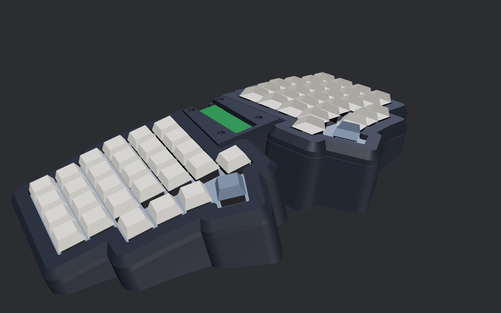
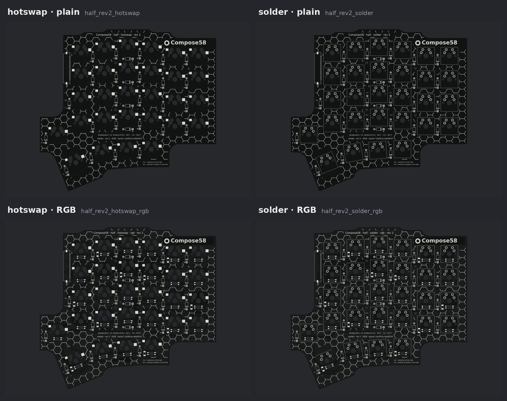
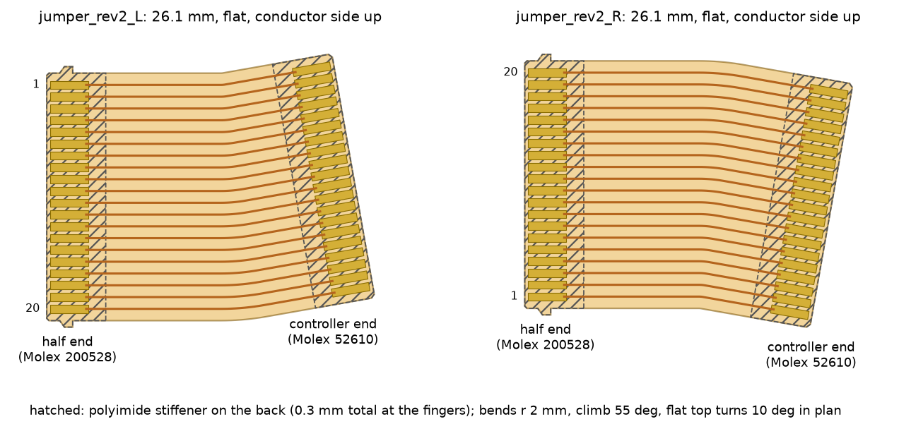
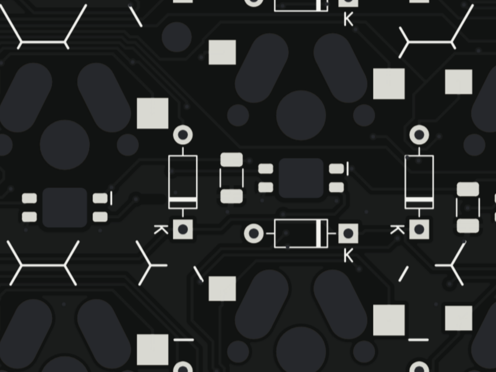
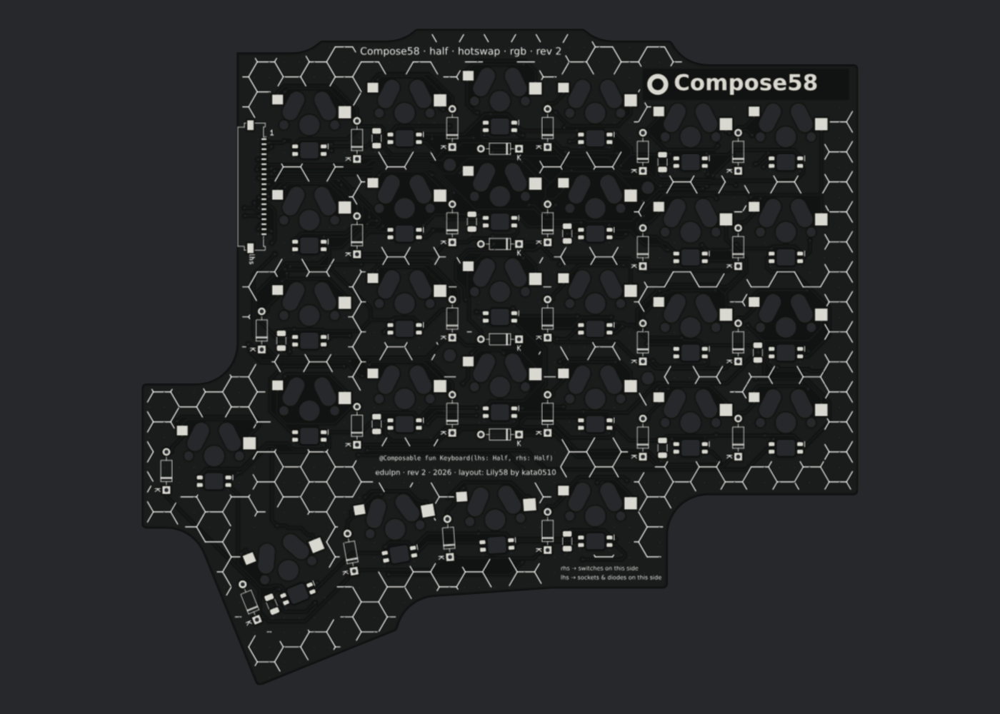

# Compose58 rev 2

[Compose58](README.md) › rev 2 · **Status: in progress.** The case, cover, controller and half boards are designed and checked; nothing is built yet.

| | rev 2 |
|---|---|
| **Case** | one-piece tub, gasket-mounted plates, bevelled frames, lift-off middle cover |
| **Controller** | the shared [controller rev 2](../../docs/controller-rev2.md) (socketed Pico, a 20-pin vertical connector per half) |
| **Half boards** | one reversible board for both halves, in four variants: hotswap or solder, with or without per-key RGB |
| **Jumpers** | a custom 20-conductor flex PCB per half, 26 mm, bent to shape; left and right are mirror images |
| **Angles** | splay 10°, tent 12°, tilt 0° (provisional) |
| **Hardware** | M3 screws and heat-set inserts; M2 for board to plate |

**On this page:** [The case](#the-case-gasket-mount) · [The half boards](#the-half-boards) · [Design notes and ideas](#design-notes-and-ideas)

## The case: gasket mount

All rev 2 commands need `C58_REV=2` (rev 1 is the default and is untouched).

| command | what it does |
|---|---|
| `gasket-case out_r2t` | builds the printable parts into `out_r2t/print/` (`compose/case/gasket.py`) |
| `gasket-checks out_r2t` | fit, gasket, assembly, jumper and printability checks |
| `gasket-sections out_r2t` | cross-section drawings |
| `gasket-render out_r2t` | renders |

### Defaults

| | default | override |
|---|---|---|
| splay | 10° | `C58_SPLAY` |
| tent | 12° | `C58_TENT` |
| tilt | 0° | `C58_TILT` |
| bridge | 62 mm, 2.5 mm end walls | |

The angles come from an ergonomics research pass and stay provisional until the angle test prints are tried.

### Parts

Everything prints without supports, in print orientation:

| part | qty | prints | why |
|---|---|---|---|
| tub (both halves and the open middle bay) | 1 | on its floor, 332 × 161 mm on the 350 mm bed | the pad ledge steps back to the wall at 60° underneath instead of hanging off it |
| plates | 2 | switch side down, as on rev 1 | the flange (flush with the top face) lies flat on the bed; the switch-clip pockets open upward |
| frames | 2 | upside down, visible top on the bed | bevels are 56° from the bed |
| middle cover | 1 | upside down, visible top on the bed | same |

- **Look:** rev 1's bevelled frames (6 mm tall, 4 mm inset) and the reveal line over the tub's top edge. Outer corners are rounded at 4.5 mm so the bevel stays clean all the way round.
- Every mesh is checked watertight with no non-manifold edges, and sliced layer by layer for overhangs.

### How the gasket mount works

- Each **plate** is a 5 mm core holding the switches, with a thin 2 mm flange round its edge, flush with its top face.
- The **flange is pinched between foam pads**: pads on a ledge in the tub below, pads under the frame above. Nothing screws through the plate or the half board.
- Each **frame** screws to the tub from below with six M3 screws into heat-set inserts and bottoms out on the tub's bosses. The squeeze is set by geometry, not by how hard the screws are tightened.
- The plate **floats 0.6 mm clear** of the walls and the frame sideways.

### Pads: ordinary foam weatherstrip tape

| | |
|---|---|
| material | self-adhesive closed-cell EPDM or neoprene sponge |
| tape | 1/8″ (3 mm) thick, 3/8″ or 10 mm wide |
| pad | a 4 mm slice cut across the tape with scissors: 10 mm along the edge, 4 mm inward |
| where | stuck to the tub's ledge and to the frame's underside |
| squeeze | installed at 2.1 mm: 30–34 % for 3.0–3.2 mm tape (the foam is happy at 25–50 %) |
| count | 20 pad pairs per half |

18 of the pairs are found by scanning the plate edge for every spot where a slice fits between the plate edge and the half board. The other two sit at the ends of the inner (bridge) edge, on seats that stand straight up from the floor so they don't lean into the controller.

### Middle bay

- The controller sits on four floor posts (M3 inserts), clamped by its four M3 standoffs; there are 24 mm under the board.
- The cover drops onto the standoffs and takes four M3 × 6 screws. It comes off without touching the jumpers.
- The bay is open from wall to wall below the plates' inner edges, so each jumper climbs out of its half's connector, crosses the gap and drops straight into the controller's connector ([jumpers](#flex-jumpers)).

### Checked (`gasket-checks`: 131 checks, all passing)

| check | result |
|---|---|
| overlaps | none between parts that mustn't touch: tub, plates, frames, cover, controller board and the parts on both its faces, Pico stack, standoffs, the real underside parts of every half-board variant, jumpers, pads |
| clearances | plate–tub 0.6 mm, plate–frame 0.58 mm, cover–frames 0.3 mm, board–tub 0.5 mm, Pico–cover 0.7 mm |
| pad gap | 2.10 mm at every pad, top and bottom, measured on the solids along the plate normal |
| assembly paths | plates and frames drop in along the plate normal; the controller and the cover drop straight down |
| hardware | cover screws 2.95 mm into the standoffs, standoff threads 4.4 mm into the inserts; Pico gap 0.96 mm, header plugs under the cover |
| jumpers | the bent shape solved from the case: plate 1.69 mm away (≥ 1.0 for the gasket's travel), half board 0.85, cover 3.60, standoffs 3.23, Pico 4.63; the controller end slides 4.1 mm straight down into its connector with the cover off |
| printability | every part sliced at 0.2 mm in print orientation; each layer rests on the one below within 45° (short bridges over hole ceilings and lips up to 1.2 mm allowed). A plate with the flange halfway up its edge, the earlier design, fails this. |

### Hardware (case)

| part | qty |
|---|---|
| M3 × 6 button-head screws (12 for the frames, driven up from under the case through the bosses; 4 for the cover) | 16 |
| M3 × 5 × 4 heat-set inserts (12 in the frames, 4 in the controller posts) | 16 |
| M3 × 12 male–female hex standoffs, 5 or 5.5 mm across flats (controller) | 4 |
| foam weatherstrip tape, closed-cell EPDM/neoprene, self-adhesive, 1/8″ × 3/8″ (3 × 10 mm), ~0.4 m | 1 roll |
| rubber bumpons, 10 mm | as rev 1 |

## The half boards

`C58_REV=2 python3 -m compose half-rev2 out_r2t` builds all four boards (place, route, DRC, Gerbers; `--plan` draws the placement only). The code is `compose/pcb/rev2_half.py`.

| board | switches | LEDs |
|---|---|---|
| `half_rev2_hotswap` | Kailh MX hotswap sockets | none |
| `half_rev2_solder` | soldered | none |
| `half_rev2_hotswap_rgb` | Kailh MX hotswap sockets | SK6812 MINI-E under every switch |
| `half_rev2_solder_rgb` | soldered | SK6812 MINI-E under every switch |

Pick hotswap or solder, and RGB or not, the way you'd pick on any keyboard. Order five of the one you want (two per keyboard).

> **The RGB boards are experimental.** They pass the same DRC and copper simulation as the plain boards, but nobody has built one yet. Before you order:
>
> - **LED footprint.** Checked against the OPSCO SK6812MINI-E datasheet (rev 04): the pinout, the pin corners for reverse mounting, the 3.2 × 2.8 mm body and the pad pitch all match. The pads are 1.2 mm long instead of the recommended 1.8 (they stay 0.45 mm from the cutout, for the copper-to-edge rule), so each lead sits on 0.69 mm of pad. The cutout has no orientation chamfer: orient each LED by the pin 1 mark on the silkscreen.
> - **Power.** The firmware caps brightness at 32/255 (about 0.13 A per half). Without the cap, each half's 29 LEDs can draw about 1 A at full white (36 mA each): more than the controller's 0.5 A polyfuse and USB's 0.5 A allow, and too much for the signal-width 5 V tracks. (Both connectors' contacts are rated 1.0 A each, two per rail.) Keep the cap.
> - **Decoupling.** There's one 100 nF capacitor per three LEDs (to limit inrush when the keyboard is plugged in), not the one per LED the datasheet suggests. That's fine at the capped brightness.
>
> If you build one, please report what you find.

### Layout

- **One reversible board for both halves**, as on rev 1. The left half has its switches on the front and everything else on the back; the right half is the same board flipped over.
- **Every one-sided part has a copy on each face**: sockets, LEDs, capacitors, the jumper connector. Fit only the copies on the face away from the switches. Through-hole parts (diodes, solder-in switches) serve both.
- **One placement for all four boards**: diodes, mounting posts and the connector sit in the same spots on every variant, so one plate fits them all.
- **Outline:** the plate outline less 5 mm, inside the gasket pads. No case screws go through it: the board hangs from the plate on four M2 screws into heat-set inserts in the plate, placed in column gaps clear of every part.
- **Matrix:** the layout's rows and columns, COL2ROW, a through-hole diode per key in the column or row gap beside it. The plate has a shallow pocket over each diode's top-side solder joint.

### Jumper connector

- **Connector:** Molex 200528-0200 (20 positions, 1.0 mm pitch, right angle, bottom contact, 1.9 mm tall) on the bottom face, flush with the inner edge. Its contact row sits on a line set from the controller (`JUMPER_ROW_Y` in `compose/pcb/rev2_half.py`, a layout choice) where the jumper lands with a gentle climb. Checked against Molex's drawing: contact side, 4 mm insertion depth, slot about 1.0 mm above the board, 21 mm width; the case checks use its 2.1 mm worst-case height. Its actuator flips up to 3.95 mm while the jumper goes in, so plug the jumpers in before the board goes into the case. Contacts follow the [controller rev 2](../../docs/controller-rev2.md) slot order by physical position: the back-most contact is slot 1, on both halves.

| slots | signal |
|---|---|
| 1, 4, 20 | GND |
| 2, 19 | 5 V |
| 3 | RGB data in |
| 5–11 | COL0–COL6 |
| 12–17 | ROW0–ROW5 |
| 18 | RGB data out |

COL6 and ROW5 aren't used by this layout. The plain boards wire slot 3 straight to slot 18, so the controller's RGB chain still passes through, and leave 5 V and GND unconnected.

### Flex jumpers

The controller's two connectors are vertical (Molex 52610) and square to its edges; each half's connector runs along the half's splayed, tented edge. A custom flex PCB per half joins them, bent to a fixed shape so it never has to twist or hang slack. `C58_REV=2 python3 -m compose flex-jumper out_r2t` solves the shape from the case and writes both boards (`compose/pcb/jumper.py`).

| | |
|---|---|
| path, from the half | 1 mm of stiffener out of the connector, a bend up, a 55° climb, a bend over, a flat top that turns 10° in plan (the splay), a bend down, a short drop, 1 mm of stiffener above the controller's slot |
| bends | every bend r 2 mm, each about one axis: the flat cut-out folds into shape, nothing twists |
| size | 26.1 mm long, outline 27.7 × 23.1 mm, 21 mm wide |
| conductors | 20, 0.5 mm wide at 1.0 mm pitch, single-sided; slot k at one end meets slot k at the other |
| half end (200528) | 0.7 mm gold fingers, 3.5 mm exposed, retention ears 0.55 mm proud between 1.5 and 2.2 mm from the tip; conductors face up |
| controller end (52610) | 0.7 mm gold fingers, 3.5 mm exposed, two C0.3 chamfers; conductors face inboard, toward the Pico |
| stiffeners | polyimide on the back of each end, 0.3 mm total thickness at the fingers (both connectors take 0.3 ± 0.05), 5.0 mm at the half end and 5.1 mm at the controller end |
| DRC | 0 errors, 0 warnings, 0 unconnected (the open finger fields' solder-mask bridges are by design and reported apart) |

**Ordering (JLCPCB flex):** upload `jumper_rev2_L_JLCPCB.zip` and `jumper_rev2_R_JLCPCB.zip` as two designs (they are mirror images; one of each per keyboard).

| option | choose |
|---|---|
| layers | 1 (single-sided flex) |
| surface finish | ENIG (Molex asks for gold-plated contacts) |
| coverlay | yes; the openings are on the mask layer (the two finger fields) |
| stiffener | polyimide, on the back, total thickness 0.3 mm at the fingers; areas on layer User.1 (note them in the order remarks) |
| copper | any (the circuit simulation assumes the thinnest, 1/3 oz) |

Plug the jumper into the half's connector first (fingers toward the half board, then close the actuator), then set the board in and drop the other end straight down into the controller's connector with its slider open, then close the slider. Molex's application spec: insert the cable straight and keep it free of tension; the solved shape does both.

### RGB boards

| | |
|---|---|
| LED | SK6812 MINI-E, reverse mount, in a cutout under each switch's LED window; soldered on the bottom face, shining up through the board into the switch |
| light | comes out on the near side of each key ("south-facing"): MX switches have their LED window opposite their pins, and the pins point away from you. Any MX switch with an LED window works; sockets and LEDs never share a side. |
| chain | one per half: up the outer column, down the next and so on, then the inner key and the thumb arc from the inside out |
| capacitors | 100 nF 1206 beside every third LED (10 per half) |
| power | 5 V from slots 2/19, GND from slots 1/4/20 |
| GND | a copper pour on both faces, stitched with vias. Every SMD GND pad (LEDs, capacitors, connector) has its own via on a short stub, placed before routing, so the pour reaches it on both faces whatever the tracks do around it. (With every pad doubled for both halves, GND as tracks didn't fit on two layers.) |

### Firmware

`C58_REV=2 python3 -m compose firmware-rev2 out_r2t` writes:

| file | for |
|---|---|
| `firmware/keyboard.json` | plain boards |
| `firmware/rgb/keyboard.json` | RGB boards: RGB Matrix, 58 LEDs, brightness capped at 32 |

Both use the controller rev 2 pin map: a 6 × 14 matrix, left keys at their own row and column, right keys at column 13 − col.

### Checked

| check | result |
|---|---|
| DRC, all four boards | 0 errors, 0 warnings, 0 unconnected (the unconnected count also proves the GND pour reaches every GND pad) |
| `sim-half-rev2`, all four boards | passing |
| case checks | the real underside parts of every variant at once, and the jumpers |
| plate | its M2 inserts and diode pockets come from the shared placement, so one plate fits all four boards |

`C58_REV=2 python3 -m compose sim-half-rev2 out_r2t` rebuilds each board's netlist from its copper alone and fits the parts as a builder would, the left half one way up and the right half flipped. For each board and both halves it checks:

- every key runs column slot → switch → diode → row slot;
- spare slots stay unconnected;
- RGB boards: one unbroken LED chain from slot 3 to slot 18, with every LED and capacitor across 5 V and GND;
- plain boards: the RGB pass-through.

Then it checks the jumpers: each jumper board's copper rebuilt the same way, and the flat cut-out folded along its solved path, so every finger has to land on a contact of the half's connector and of the controller's (it does, within 0.01 mm) and slot k meets slot k. Then it scans end to end with QMK's COL2ROW scan, through the real controller rev 2 copper and both jumpers: every key alone at its keymap position, 1000 random chords exact, no ghosting. Negative controls (a cut column, a diode fitted backwards, a jumper with its fingers in reverse order, a half connector 0.5 mm off along its row) are caught.

### Parts (per half)

| part | qty |
|---|---|
| half board (one of the four above) | 1 |
| Kailh MX hotswap sockets (hotswap boards) | 29 |
| 1N4148 diodes, DO-35 | 29 |
| Molex 200528-0200 connector (right angle, bottom contact) | 1 |
| flex jumper, `jumper_rev2_L` or `_R` (see [flex jumpers](#flex-jumpers)) | 1 |
| M2 × 4 screws + M2 heat-set inserts (board to plate; 2.4 mm of thread in the insert) | 4 + 4 |
| *RGB boards:* SK6812 MINI-E | 29 |
| *RGB boards:* 100 nF 1206 capacitors | 10 |

## Design notes and ideas

Collected while building rev 1; none of them blocks a rev 1 build.

| idea | status | notes |
|---|---|---|
| Per-key diode placement | done | Through-hole diodes on the single reversible board. No single spot fits all 29 keys (LEDs, capacitors and both faces' sockets crowd each switch), so each diode takes the first spot that fits from a short fixed list: column gap first, then row gap. SMD diodes would force separate left and right boards (logistics, and harder for other builders); a diode bank was too dense to route. |
| Controller rev 2 first, then the half boards | done | See [controller rev 2](../../docs/controller-rev2.md). The half-board side of the standard is done too: connector on the bottom face, same physical slot order. The halves join the controller through custom flex jumpers, so the controller stays the same whatever a layout's angles. |
| Bridge cover lifts off without touching the jumpers | done | The jumpers run below the cover's parting line; the cover never clamps, guides or closes over them. Cables to modules in the cover (OLED, pointing device) are long enough to set the cover beside the board, or unplug at the controller's front-edge connectors. |
| No perimeter screws through the half board | done | The plate edge is clamped in the gasket between frame and case: fewer parts than 14 through-screws. |
| Ergonomic defaults | provisional | Tent, splay plus separation (tied together on a unibody), front-to-back tilt (studies tend to favour flat or negative tilt over rev 1's 5°) and typing height, from a research pass; to be weighed against rev 1 daily use and the angle test prints. Other angles: regenerate from `compose/params.py` and order your own half boards and jumpers (the controller is unaffected). |
| Flex cuts in the half board | open | Paired with a thinner plate (a parametric web thickness, 5 mm only at the supports). Only meaningful with the gasket mount. |
