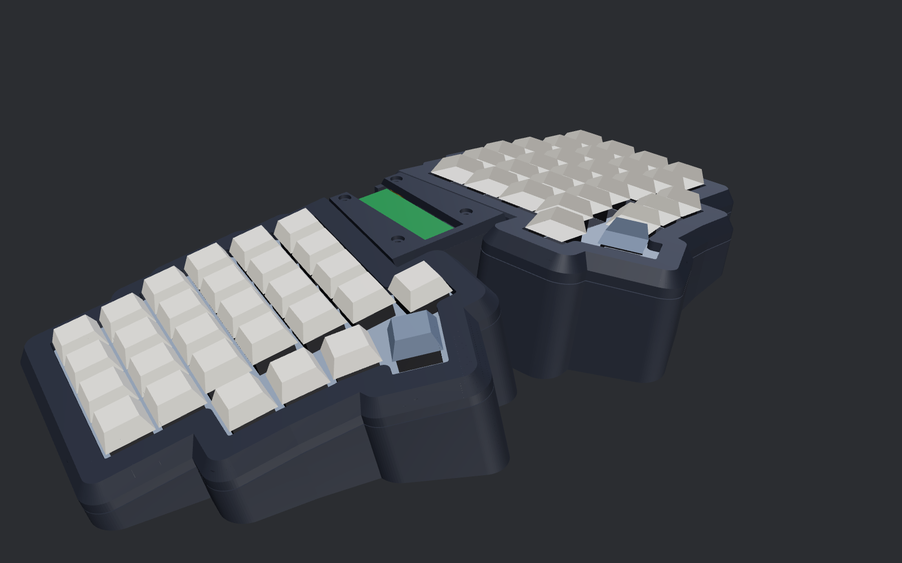
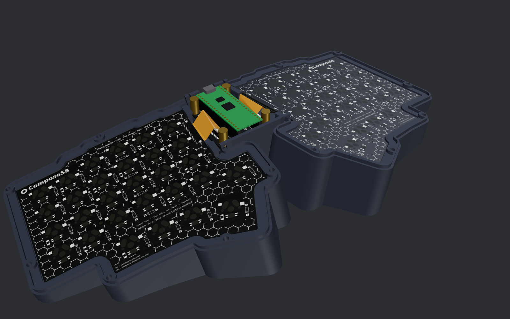
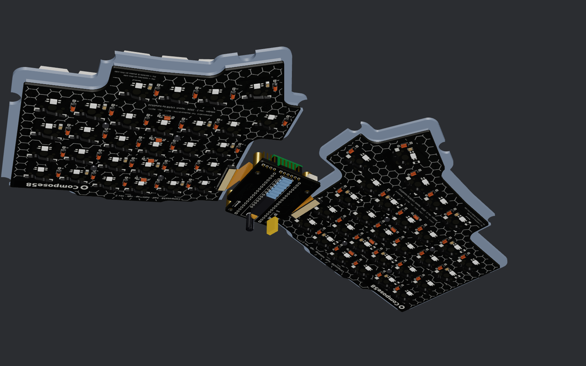
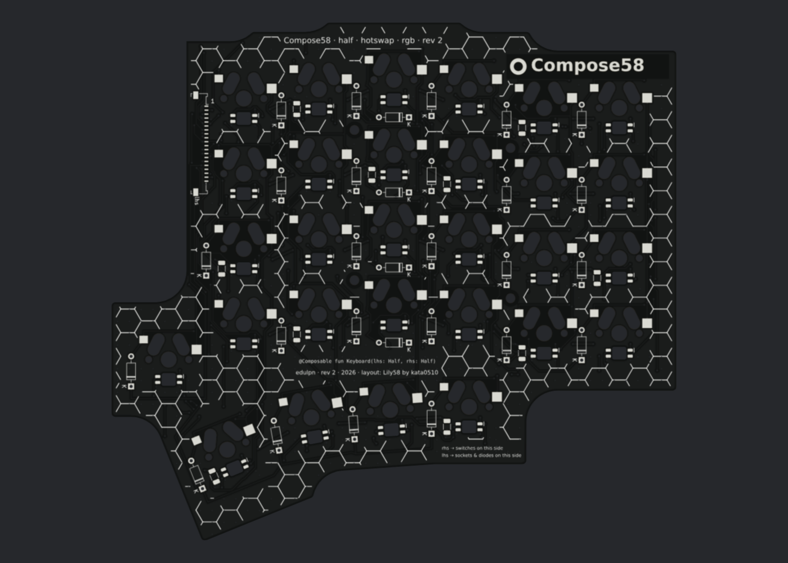

# Compose58 rev 2

[Compose58](README.md) › rev 2 · **Status: in progress.** The case, cover, controller and half boards are designed and checked; nothing is built yet.

| | rev 2 |
|---|---|
| **Case** | one-piece tub, gasket-mounted plates, bevelled frames, lift-off middle cover |
| **Controller** | the shared [controller rev 2](../../docs/controller-rev2.md) (socketed Pico, a 20-pin vertical connector per half) |
| **Half boards** | one reversible board for both halves, in four variants: hotswap or solder, with or without per-key RGB |
| **Jumpers** | one custom 20-conductor flex PCB for both halves (two per keyboard), 27.6 mm, bent by hand as it's plugged in |
| **Angles** | splay 10°, tent 12°, tilt 0° (provisional) |
| **Hardware** | M3 screws and heat-set inserts; M2 for board to plate |

**How rev 2 works** is on the platform's pages: [rev 2](../../docs/rev2.md) · [the gasket-mount case](../../docs/gasket-case.md) · [controller rev 2](../../docs/controller-rev2.md) · [half boards](../../docs/half-boards-rev2.md) · [flex jumpers](../../docs/flex-jumper.md) · [building from source](../../docs/building.md). This page is what Compose58 gets from them: its sizes, its parts and what its checks returned.

**On this page:** [The case](#the-case) · [The half boards](#the-half-boards) · [Flex jumper](#flex-jumper) · [Firmware](#firmware)

## The case

How it works: [the gasket-mount case](../../docs/gasket-case.md).

| | |
|---|---|
| tub | one print, 332 × 161 mm, on a 350 mm bed |
| pads | 20 pairs per half: 18 found along the plate edge, 2 at the ends of the inner (bridge) edge |
| frame screws | six M3 per frame |

### Checked (`gasket-checks`: 132 checks, all passing)

| check | result |
|---|---|
| layout | 29 keys per half, keycaps at least 0.5 mm apart; the inner edge straight along the whole centre section |
| overlaps | none between parts that mustn't touch: tub, plates, frames, cover, controller board and the parts on both its faces, Pico stack, standoffs, the real underside parts of every half-board variant, jumpers, pads |
| clearances | plate–tub 0.6 mm, plate–frame 0.58 mm, cover–frames 0.3 mm, board–tub 0.5 mm, Pico–cover 0.7 mm |
| pad gap | 2.10 mm at every pad, top and bottom, measured on the solids along the plate normal |
| assembly paths | plates and frames drop in along the plate normal; the controller and the cover drop straight down |
| hardware | cover screws 2.95 mm into the standoffs, standoff threads 4.4 mm into the inserts; Pico gap 0.96 mm, header plugs under the cover |
| jumpers | the bent shape solved from the case: plate 1.53 mm away (≥ 1.0 for the gasket's travel), half board 0.90, cover 1.71, standoffs 3.37, Pico 4.44; the controller end slides 4.1 mm straight down into its connector with the cover off |
| printability | every part sliced at 0.2 mm in print orientation; each layer rests on the one below within 45°, with no step wider than one 0.45 mm extrusion line. The exceptions are short bridges over hole ceilings and the 12 frame-screw seats: flat shoulders for the M3 heads, which the tent tilts so each layer exposes a thin crescent, inside the counterbore. A plate with the flange halfway up its edge, the earlier design, fails this. |

### Hardware (case)

| part | qty |
|---|---|
| M3 × 6 button-head screws (12 for the frames, driven up from under the case through the bosses; 4 for the cover) | 16 |
| M3 × 5 × 4 heat-set inserts (12 in the frames, 4 in the controller posts) | 16 |
| M3 × 12 male–female hex standoffs, 5 or 5.5 mm across flats (controller) | 4 |
| foam weatherstrip tape, closed-cell EPDM/neoprene, self-adhesive, 1/8″ × 3/8″ (3 × 10 mm), ~0.4 m | 1 roll |
| rubber bumpons, 10 mm | as rev 1 |

## The half boards

How they work: [rev 2 half boards](../../docs/half-boards-rev2.md).

| boards in the case (plates off) | underside, case off: half boards on their plates, jumpers into the controller |
|---|---|
|  |  |

*Renders from `gasket-render`: the boards wear their own Gerbers, and every part sits where its footprint is on the routed board.*

| | |
|---|---|
| keys | 29 per half; COL6 and ROW5 of the connector are spare |
| LEDs, capacitors (RGB boards) | 29 and 10 per half; 0.13 A per half at the brightness cap, about 1 A without it |
| connector | its contact row 0.72 mm forward of the controller's Pico centre |
| routing | Freerouting 2.5.0 on all four boards; the hotswap RGB board with seed 8 ([Routing](../../docs/building.md#routing)) |
| diode joints, hotswap boards | 0.46 mm from a socket's column pad at the nearest; 33 joint-and-pad pairs within 1.5 mm, counting both faces. Keep those joints small and look at each one before the switches go in. None within 1.5 mm on the solder boards. |

### Laid out by hand

What [`preroute.py`](preroute.py) lays before the autorouter runs, beside ROW4 (the thumb row) on all four boards:

| | |
|---|---|
| 5 V rail | laid out by hand before the autorouter runs ([`preroute.py`](preroute.py)): a 0.5 mm trunk along every key row, between each switch's centre hole and its LED cutout, with a spur to each LED and capacitor (a via where the pad is on the back). Under a key the trunk is on the front copper; it crosses each column gap on the back, so both faces keep room for what has to cross a row. The rows are tied into a mesh by a 1 mm spine down the outer edge and a 0.8 mm one down the inner edge; slot 2 feeds the top row, slot 19 the second row and the inner spine. `sim-half-rev2` reads its resistance from the routed copper: from the connector to the farthest LED, 81 mΩ as the left half and 76 mΩ as the right on the solder RGB board, 82 and 77 mΩ on the hotswap RGB board. It reads the return too, through the GND pour (both faces, with the pads' stubs and vias) from the worst LED's GND pad back to slots 1, 4 and 20: 14 and 12 mΩ on the solder RGB board, 31 and 27 mΩ on the hotswap RGB board. The worst rail and the worst return together are held to 150 mΩ, the figure the controller's power simulation allows a half; the most is 113 mΩ (hotswap RGB, left half). All of these figures include 20 % for temperature and plating tolerance. |
| D nets, hotswap RGB board | laid out by hand too: each key's socket pad on either face to its diode. The sockets' pads sit on both faces, so every key needs two links across the board (D and its column), and with the rail laid as well the autorouter didn't finish the board. Each D net runs from the pad beside the diode straight to the diode on that pad's face, and on over the top of the switch to a via above the other pad. The columns, the rows and the LED data are left to the autorouter (Freerouting 2.5.0, see [Routing](../../docs/building.md#routing)). |

### Checked

| check | result |
|---|---|
| DRC, all four boards | 0 errors, 0 warnings, 0 unconnected (the unconnected count also proves the GND pour reaches every GND pad) |
| `sim-half-rev2`, all four boards | passing |
| case checks | the real underside parts of every variant at once, and the jumpers |
| connector gap | the jumper connector's pads ≥ 0.6 mm from every other part's pads on its face, both halves (0.61 mm at the nearest socket tab) |
| `flex-sim` | the jumper as an elastic strip: seated, insertion, gasket travel and length all pass (see [below](#flex-jumper)) |
| plate | its M2 inserts and diode pockets come from the shared placement, so one plate fits all four boards |

What `sim-half-rev2` checks, and how: [the half boards page](../../docs/half-boards-rev2.md#what-sim-half-rev2-checks).

### Parts (per half)

| part | qty |
|---|---|
| half board (one of the four above) | 1 |
| Kailh MX hotswap sockets (hotswap boards) | 29 |
| 1N4148 diodes, DO-35 | 29 |
| Molex 200528-0200 connector (right angle, bottom contact) | 1 |
| flex jumper `jumper_rev2`, the same part on both halves (see [flex jumpers](../../docs/flex-jumper.md)) | 1 |
| M2 × 4 screws + M2 heat-set inserts (board to plate; 2.4 mm of thread in the insert) | 4 + 4 |
| *RGB boards:* SK6812 MINI-E | 29 |
| *RGB boards:* 100 nF 1206 capacitors | 10 |

## Flex jumper

How it works, and how to order it: [flex jumpers](../../docs/flex-jumper.md).

| | |
|---|---|
| path, from the half | 1 mm of stiffener out of the connector, a bend up into a 60° climb, a bend over, a short straight, a bend down into a short drop, 1 mm of stiffener above the controller's slot |
| bends | three, r 2 mm, each a plain cylindrical bend. Their bend lines cross the strip 4.6°, 6.4° and 5.1° off square: that's what turns it by the splay, so nothing twists and the flat strip needs no curve. The straights between them are long enough that neighbouring bend lines never meet. |
| size | 27.6 × 21 mm (22.1 mm across the half end's retention ears): the solved path plus 0.5 mm of slack, which eases the bends while the controller end goes in (see the simulation below) |
| DRC | 0 errors, 0 warnings, 0 unconnected (the open finger fields' solder-mask bridges are by design and reported apart) |

`flex-sim`, the jumper as an elastic strip:

| scenario | result |
|---|---|
| seated | settles within 1.2 mm of the designed path, with half its bending energy (it spreads the bends out); tightest bend at the copper 1.44 mm, strain 1.04 % (limit 1.5 %) |
| insertion: the controller end lifted 4.1 mm to go into its slot | reaches it; copper strain 2.28 % for that moment (limit 2.5 %: half of rolled-annealed copper's ~5 % minimum elongation). The 0.5 mm of slack is what brings it there (3.0 % without). |
| gasket travel: the half end moving with the plate, ±0.2 mm per keystroke (a generous bound by the inner-edge pads) | every signal conductor flexes ≤ 0.13 % (fatigue limit 0.2 %, ≥ 10⁷ cycles). Only the outermost GND (slot 1, 0.33 %) and 5 V (slot 2, 0.21 %) go past it, at the corner where the drop meets the controller-end stiffener; each has a twin well under (GND 4 and 20, 5 V 19). |
| rare excursions, 0.5–1.0 mm | settles every time; copper strain up to 0.71 % (low-cycle) |
| clearances, seated, over the travel and ±0.5 mm of length | plate ≥ 1.72 mm, cover ≥ 0.86, half board 0.90, controller board ≥ 2.20; no overlap with either connector or anything else |

## Firmware

`C58_REV=2 python3 -m compose firmware-rev2 out_r2t` writes `firmware/keyboard.json` for the plain boards and `firmware/rgb/keyboard.json` for the RGB boards: 58 keys, and on the RGB boards 58 LEDs with the brightness capped at 32. What the cap covers and how to build with it: [firmware](../../docs/half-boards-rev2.md#firmware).
